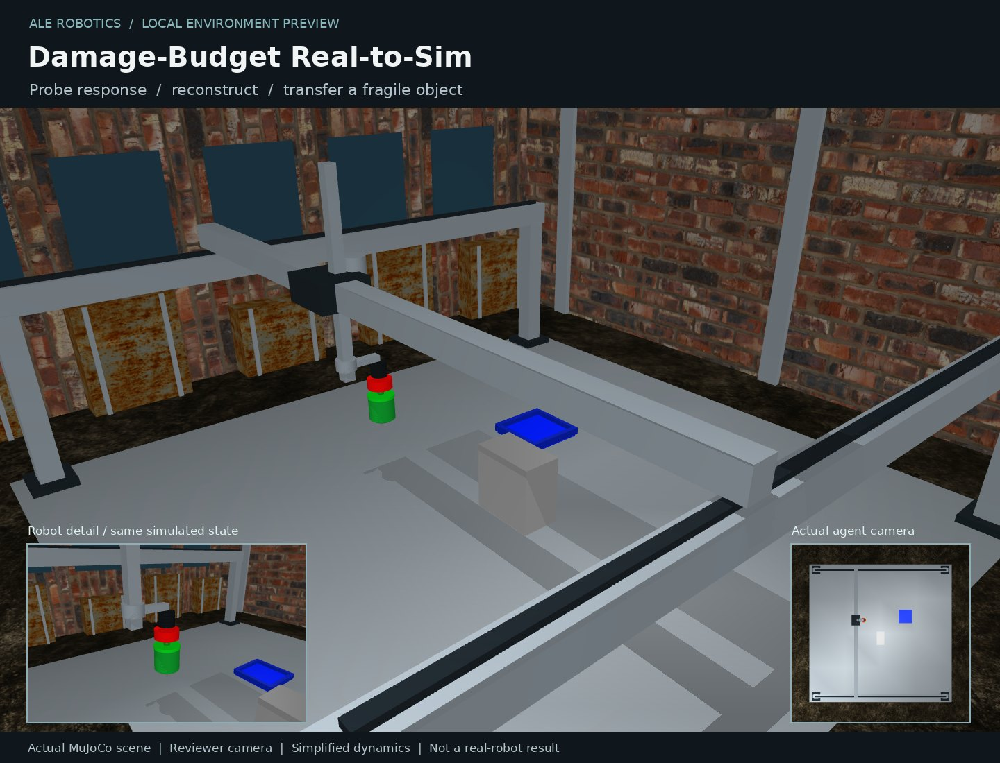

# Damage-Budget Real-to-Sim-to-Real

**Draft task candidate.** Explore an unknown workcell using two RGB views, reconstruct a MuJoCo scene, and deliver a controller that transfers a fragile object to a tray.



The large image is a reviewer view. The inset and [agent-view.png](agent-view.png)
show the actual restricted observation; the agent never receives the reviewer camera.
Robot meshes and textured scenery are present in the live simulator, not a marketing mockup.

## Scene randomization

Object, tray and obstacle positions; three independent hidden actuator gains; lighting and workcell details. Gains remain fixed throughout exploration and reconstruction of that scene.

The trusted service draws a private scene seed per episode. A repeated seed reproduces
the scene. Reconnecting does not resample it or refund budgets. The environment varies
between episodes, not arbitrarily between steps of the same learning problem.

## Local validation

- Pinned ALE engine: `90a7c1cfa649c5dbf1078714773f99840e44cba3`; CPU only, no model API calls.
- Image-based scripted reference: **8/8** randomized validation scenes. Control-only transfer checks in these eight scenes; reconstruction prediction is evaluated separately by the real ALE gate.
- Successful development example: seed 101, 70 actions, 0 collisions.
- Six-seed determinism, variation and applicable phase-persistence checks passed.
- Fourteen shared service permission/forgery checks passed through the bridge-task ALE sandbox;
  forged success scored zero. This does not constitute a complete security audit.
- Anchor `quality_adjusted_success` measured from 2 real ALE oracle runs;
  final gate repeated separately after calibration.

```text
ok    damage_budget_real_to_sim: untouched={'reward': 0.0}, oracle={'reward': 1.0}
```

Raw per-case outcomes, real gate episode IDs and metrics are in
[validation-evidence.json](validation-evidence.json). The successful run is in
[success-example.json](success-example.json), with its [interaction log](success-interaction.json).
These are validation scenes, not an untouched benchmark test set or model results.

## Reproduce

From the repository's pinned `vendor/ale` directory:

```bash
uv run ale lint ../../tasks/arm/damage_budget_real_to_sim
uv run ale validate ../../tasks/arm/damage_budget_real_to_sim --runs-dir /tmp/damage_budget_real_to_sim-validation
```

For reviewer-only scene checks, run `tools/check_randomization.py` and
`tools/review_task.py --out /tmp/damage_budget_real_to_sim-review --seeds 101 102 103`
in the task image, with `VISUAL_ROBOTICS_ASSETS=/opt/visual_robotics/assets`.
The latter saves real scene images, interactions and per-seed outcomes.

## Limits and merge blockers

A three-axis Cartesian suction gantry, not an articulated Panda arm. This is hidden-simulation reconstruction, not a hardware real-to-sim-to-real claim. Evaluation tests unseen action sequences against the reconstructed scene and controller performance separately.


Frontier/Astra benchmarking has **not** been run on this revision. Passing the oracle
gate proves implementation feasibility, not the benchmark's desired difficulty.
Keep this PR in Draft until model evaluation, independent review and coordination-sheet
registration are confirmed. The task must be strengthened if frontier scores are too high.

## Assets

Licensed Menagerie Crazyflie/Go1 meshes, CC0 Poly Haven textures and authored scene geometry.
Sources, pinned hashes and full notices are under `image/visual_assets.json` and
`image/LICENSE.*`. No proprietary warehouse or lab scene has been copied.
