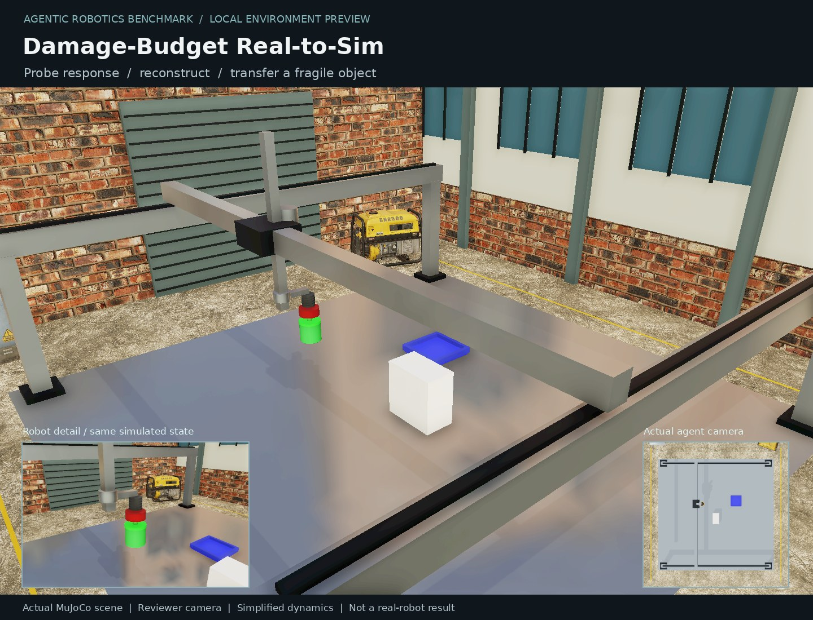

# Damage-Budget Real-to-Sim-to-Real

**Draft task candidate.** Explore an unknown workcell using two RGB views, reconstruct a MuJoCo scene, and deliver a controller that transfers a fragile object to a tray.



The large image is a reviewer camera. The inset and [agent-view.png](agent-view.png)
show the actual restricted observation. Both use the same PBR scene, not a marketing mockup.

## Visual refresh

MuJoCo 3.16 Filament runs on CPU Vulkan (lavapipe), with no GPU fallback.
The scenes include CC0 industrial scans, correctly scaled surface UVs, normal/roughness
maps, fixed-exposure lighting, and spatial supersampling. Temporal post-processing is
disabled so an unchanged scene produces identical camera pixels. Tracking stickers
remain visible; no semantic overlays or privileged state are added to observations.

Original action semantics, calibrated cameras, collision proxies, scoring and budgets
are retained. Detailed scenery has zero mass and contact response. This is a visual
upgrade of a lightweight simulation, not a claim of hardware-accurate dynamics.

## Randomization

Object, tray and obstacle positions; three independent hidden actuator gains; lighting and workcell details. Gains remain fixed throughout exploration and reconstruction of that scene.

The private seed persists throughout an episode. Reconnecting does not resample the
scene or restore budgets. Six-seed determinism/variation/phase checks passed.

## Validation

- Image-only scripted reference: **3/3** private randomized validation scenes.
- Development demonstration: seed 101, 70 actions, 0 contacts.
- Real ALE gate: **untouched 0.0 / oracle 1.0**, after measuring the new anchor.
- Anchor `quality_adjusted_success`: 0.979698211, from 5 actual oracle runs.
- CPU only; no Astra/frontier-model calls. Pinned engine `90a7c1cfa649c5dbf1078714773f99840e44cba3`.
- Shared-service security probe: 14 permission/forgery checks, forged success scored zero.

Arm random reference cases test control only; its ALE gate separately verifies model predictions and four controller transfers. The numbers above are feasibility checks, not model difficulty measurements
or a sealed benchmark test set.

[Raw evidence](validation-evidence.json) · [Success example](success-example.json) ·
[Interaction log](success-interaction.json)

## Reproduce

From `vendor/ale`:

```bash
uv run ale lint ../../tasks/arm/damage_budget_real_to_sim
uv run ale validate ../../tasks/arm/damage_budget_real_to_sim
```

Inside the task image, `tests/review/check_randomization.py` checks six scenes and
`tests/review/review_task.py --out /tmp/review --seeds 101 102 103` captures reviewer evidence.

## Limits

A three-axis Cartesian suction gantry, not an articulated Panda arm. This is hidden-simulation reconstruction, not a hardware real-to-sim-to-real claim. Evaluation tests unseen action sequences against the reconstructed scene and controller performance separately.

Keep this PR in **Draft**. Independent review, task registration and frontier-model
difficulty evaluation remain pending. Scanned props do not make a task difficult by
themselves. Earlier failures and pilot images are retained in the author's local logs.

## Assets

Powered by Poly Haven: CC0 scanned utility cabinet, generator, concrete barrier and
surface textures. Menagerie Crazyflie/Go1 visual meshes retain their original licenses.
The lighting probe ships with the Apache-2.0 MuJoCo package. Pinned URLs, SHA256 hashes
and notices are in `environment/visual_assets.json` and `environment/LICENSE.*`. No commercial
warehouse pack, private laboratory scene or generated marketing image is included.
