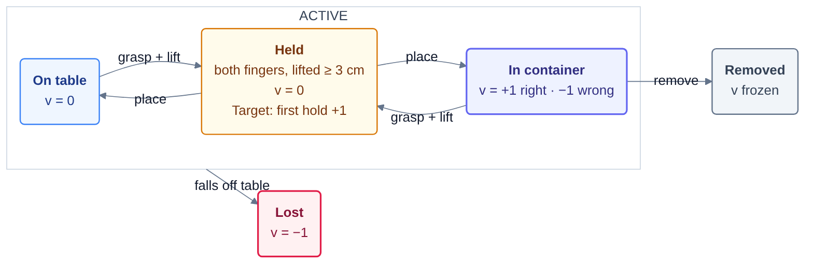
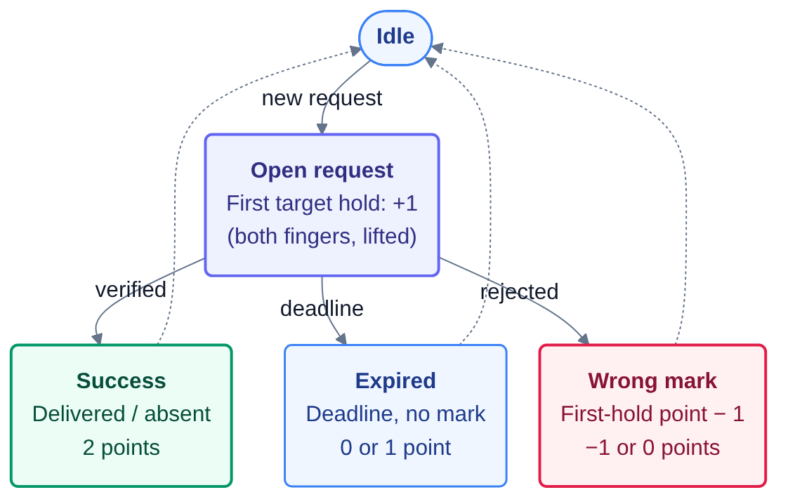

# object_finding_and_organizing_on_messy_desk — scoring and world state machine

Design notes for maintainers and reviewers. The agent-facing rules are in `instruction.md`;
the geometry in `environment/setup/payload/task_card.md`. The code is `env.py` (the simulator and
its state machine) and `messy_desk_score.py` (the score), both in this folder; the agent has
neither (see "The desk lab instead of the practice simulator" below).

## Entities

| kind | what | scored |
|---|---|---|
| robot | Franka Panda arm and two-finger gripper | no |
| table | the desk top, the plane z = 0 | no (support surface) |
| container | four KLT containers: gray (class A: boxes and blocks), light-blue (class B: cans and bottles), blue (class C: tools and kitchenware), red (deliveries); the class catalogue is in the task card | no (they define "in container") |
| target object | the object named by the open request | yes |
| non-target object | every other YCB object in the scene | yes |

## Detectors (every control step, from the simulator's privileged state)

| detector | definition |
|---|---|
| `contact(o)` | PhysX contact report between object `o` and either finger link (summed contact force > 1e-4 N); if the contact view is unavailable, the fallback is centre within 6 cm of the tool centre point |
| `held(o)` | a real grasp: contact with **both** finger links and the object lifted clear of its support, its centre at least `HOLD_LIFT` = 0.03 m above its height when it last was `placed` (a finger brushing or pushing an object does not hold it; with the distance fallback, contact alone) |
| `in_container(o)` | the object's centre lies inside a container's interior footprint in that container's own frame (\|x\| ≤ 0.140, \|y\| ≤ 0.120 m for the class containers; \|x\| ≤ 0.102 for the red one) and its height is between the floor − 0.02 and the rim + 0.12 m |
| `on_table(o)` | not inside any container, centre below 0.16 m, placed |
| `resting(o)` | speed < 0.08 m/s |
| `placed(o)` | `resting(o)` and not `contact(o)`: released by the gripper and still |
| `lost(o)` | centre below z = −0.2 m: it left the table |

## Object automaton

Key object states; node values are $v_o(t)$. First-hold credit belongs to $R$, not to $v_o(t)$.

  

<!-- Editable source: figures/object-automaton.mmd -->

The first hold (`held`, not a mere touch) of the requested target earns +1 request point once; repeated holds add nothing. “Place” means released and resting. A right container is the class container; while a request is open its object has red as its only right container, and holding it counts +1. Removal by container service or confirmed delivery freezes the value; only falling off the table triggers `Lost` and keeps −1. A release onto the table or into a container is not a loss. Transit ($v=0$), arrivals, disturbances and instance reuse are omitted for clarity.

## Request automaton

Each request earns partial credit on its first target hold, then closes as a success or failure.

  

<!-- Editable source: figures/request-automaton.mmd -->

A first target hold earns +1 point; delivery adds +1 for a total of 2. Correct absence also earns 2 points. Expiry keeps any first-hold credit but adds no completion credit; a wrong mark (delivered while the target is not placed in red, absent while it is on the desk) costs a point on top, so it ends at 0 or −1. $R$ divides total request points by twice the number of opened requests, including the ongoing one, floored at 0. The next request starts a new cycle.

Why a wrong mark costs a point: without it a mark is free to guess. One request in five names an absent object (`REQUEST_ABSENT_P`), so a controller that answers "no such object" to every request the moment it opens would earn 0.4 points per request with no search at all (the reviewer's estimate: S ≈ 0.10 for no work beyond holding the probe lock). With the cost the same strategy scores 0.2 · 2 − 0.8 · 1 = −0.4 points per request, and a mark pays only above one chance in three of being right (a "delivered" mark after the first hold, above one in two). An expiry still costs nothing: a controller that is not sure can let the deadline pass.

Why the container service waits for the open request: the worker used to empty a full class container even when it held the object the open request names. The object was then gone, delivery was impossible, and "no such object" was still wrong (the grader judges it against the object named at the opening), so the request had no right answer. The worker now leaves such a container until the request closes, then empties it.

## Score

$$
S = O \cdot R, \qquad
O = \frac{1}{K} \sum_{k=1}^{K} O(t_k), \qquad
O(t) = \mathrm{clip}\left( \frac{\sum_{o} \left( v_o(t) - b_o(t) \right)}{\sum_{o} \max\left( 0,\, 1 - b_o(t) \right)},\ 0,\ 1 \right), \qquad
R = \max\left(0,\ \frac{\sum_{j=1}^{N_{\mathrm{opened}}} q_j}{2N_{\mathrm{opened}}}\right)
$$

where $q_j = 2$ for a verified delivery or correct absence declaration; otherwise $q_j$ is
1 when the target was held at least once while the request was open and 0 when it was not,
minus 1 when the request closed on a wrong mark (so $q_j \in \{-1, 0, 1, 2\}$; an expiry or a
still open request costs nothing). Repeated holds do not accumulate credit. $R = 0$ when no
request has opened. A first hold is recorded only while the request is open and its target is
currently in `held` state; historical holds and mere contacts do not count.

where $t_1, \dots, t_K$ are the steps at which a request closes (its mark or its deadline) and
the episode's last step $T$: each request is a task, find plus organize, judged with the desk
when it closes. When the grader cuts an episode because the controller used up its time
budget, $S \leftarrow S \cdot T / H$. The budget (`controller_budget_s` in
`grader_config.json`, per episode) counts the controller's time only: the grader's wait for
every reply plus a fixed `hires_charge_s` per hi-res camera frame asked for (the simulator's
PNG encoding at a nominal price). The simulator's own time never counts, so a slower machine
makes a run longer but never changes its score; `task.toml`'s `[verifier].timeout_sec` is sized
for three full episodes of simulator time plus three spent budgets.

| term | meaning |
|---|---|
| $S$ | the episode score in $[0, 1]$, the product of the two terms (since 2026-11-08; before, $\frac{1}{2} O + \frac{1}{2} R$); the task metric `mean_episode_score` is its mean over the hidden seeds |
| $O$ | organization: the mean of the snapshots $O(t_k)$, how much of the sorting work the episode has brought (every object ever in the scene) is done when each request closes and at the last step |
| $R$ | request progress: total points divided by twice the number of opened requests, including an ongoing one |
| $v_o(t)$ | value of object $o$ at step $t$: +1 placed in its class container, −1 placed in another one, 0 on the table / held / in flight; while a request is open its object belongs to the red container only (+1 placed in red or held, −1 in any other container, 0 on the table or in flight); −1 for ever once lost, last value once removed |
| $b_o(t)$ | baseline of object $o$: its value when it entered the scene (0 for an arrival, +1 for an object that starts in its pile), when a request named it (its red-only value then; the previous baseline returns after the request closes), or when the world last moved it (−1 after a misplacement; re-read once a nudged object rests again) |
| $v_o(t) - b_o(t)$ | the agent's net effect on object $o$: untouched objects contribute 0 |
| $\max(0, 1 - b_o(t))$ | the gain that was available for $o$: 1 for a loose object, 2 for one the world misfiled, 0 for one already in place |
| $t_k$, $K$ | the steps at which a request closes plus the last step $T$, and their number (5 in a full episode) |
| $T$, $H$ | the episode's last step and the horizon (20000); an episode the grader cuts because its controller used up its time budget is scaled by $T/H$ |
| $q_j$, $N_{\mathrm{opened}}$ | points for request $j$ (−1, 0, 1 or 2), and the number of requests opened; $R = 0$ when none opened |

Properties: an untouched scene scores exactly 0 (every $v_o = b_o$, no successful request);
an episode in which no request earns a point scores 0 however well the desk is sorted, and
request points earn only as much as the desk is in order;
holding an object inside a container is not "placed", so it earns no organization credit;
the first target hold can still earn request credit, but only a real grasp (both fingers, lifted)
counts, never a brush of a finger; a guessed mark loses on average; knocking an object
off the table is as bad as misfiling it and cannot be undone; an aborted episode (protocol
error, step deadline, malformed action) scores 0 and stays in the mean. The grader scales the
measured mean by the oracle's anchor and `full_at` (see `tests/anchor.json`); nothing the
controller prints is a scoring input.

## Hidden episodes, the privileged reference and the anchor (2026-11-04)

The owner's direction for this task: the reference shows that the episodes can be done by planning from
ground truth the agent never gets, on a fixed set of hidden episodes it completes; the anchor is its own
near-full score there, so that a perception-based controller has real headroom. What the agent sees and must
do is unchanged.

**The fixed episode set.** `episodes.json` holds the hidden episodes: three seeds drawn once (64-bit, OS
entropy; none is a practice seed, the practice grader of the time used 11, 22, 33, 44, 55) and the hidden key of their probe
streams. The same seeds run in the same order for every submission. They were chosen as follows. 40 seeds were
drawn (in three batches, each before any of its seeds ran). The privileged reference ran them in drawn order, each in
a simulator process of its own over the full 20000 steps; a seed was kept if the reference scored at least 0.90 (the
maximum is 1.0), and its run was stopped as soon as it no longer could (a request closed at 0 points caps R at 0.75
and S at 0.875). 14 ran: draws 3, 10 and 14 were kept (S = 0.9098, 0.9487, 1.0000), the other 11 dropped at a request
that closed at 0 points, nine because the named object lay in a container against a wall or in a corner where no
pinch fits (five of them objects of the initial piles), two because its grasps kept failing (a can leaning against a
wall, the pitcher base). Draws 15-40 were not run. `episodes.json`'s `source` lists them.

**One simulator per episode.** Each episode runs in a simulator process of its own, so its world never depends on
the episodes before it, and its probe schedule (which steps are asked twice, in which order, how the
proprioception is perturbed) comes from a stream keyed by the set's key and the episode's seed: nothing in verify
draws from the clock or from OS entropy any more. The simulator's CPU physics is deterministic: the privileged
reference's three episodes came out 0.9097910810 / 0.9487288311 / 1.0000000000 in all three measurements (the
selection runs, the controller in-process in a long-lived container with 16 cores; a verify run in a fresh
container; ale validate run validate-5b3a7b17, the engine's own sandbox under an 8-CPU quota). That controller reads
no pixels; whether the renderer repeats its images exactly, which a controller working from the cameras would also
need, was not measured.

**What the set fixes, and what it does not.** An episode's initial state (the containers' poses, the piles, the
loose objects) and its random stream are fixed, so the same submission meets the same episode every time. The world
draws its later events from that stream inside branches that depend on what the controller did (an arrival draws its
model only while fewer than six objects are loose, a desk spot by rejection sampling around the objects present, a
disturbance and a request among the objects at rest or present), so a different controller's episode diverges from
the reference's at its first different action. The selection therefore vouches for the reference's own episodes;
another controller can meet a request the reference never met.

**The simulator's cold start.** In a fresh sandbox the first start compiles the renderer's shaders: 229-621 s in
four fresh containers on an RTX 4090 (driver 580.178); later starts in the same sandbox take 5-22 s. The separate
verifier is always fresh, so its first episode pays this. `sim_ready_timeout_s` is 1500 (about 2.4x the slowest
measured start), and `sim_client.py`'s default is the same (the agent's `lab_client.py` keeps it, so that the
desk lab's cold start is not killed either).

**The privileged reference.** `solution/solve.sh` installs `solution/privileged/oracle.py` and the reference token
(`.oracle_token`; this folder keeps only its sha256, `oracle_token.sha256`). `verify.py` reads the token before
any submission code runs (a regular file, opened without following a link, at most 4 KB) and, on a match, adds a
`privileged` block to every observation: every present object as the simulator scores it (identity, pose, scale,
state, container, held, contact, resting), the episode's container poses, the open request with its object (null
when the named model is absent) and the true proprioception (a probed step's perturbed copy keeps the true block).
A token that is present but wrong is ignored. The metrics record `privileged_mode` and `oracle_token_mismatch`;
nothing agent-visible names the channel. The controller plans pinch grasps on each object's stock mesh at its true
pose (`geometry.json`), puts objects only where it can grasp them again, digs out what a request names by taking
off whatever is in its way, marks "no such object" only for an absent model and "delivered" only for an object at
rest in red, and puts the desk in order before each mark. It relies on three measurements of this simulator: the
table's collider top is at z = 0.0153 (a raycast; the task card says -0.0014), the containers stand sunk into it
(their effective floor is the same height), and the open fingertips are 1.23 cm below the tool centre (the finger
meshes on the stage; the task card says 2.7 cm).

**The non-privileged reference.** `solution/reference_v17/` is oracle v17, the reference that works from the
observation alone (cameras, proprioception, the request text). It shows what a controller limited to the agent's
observation reaches; `solve.sh` does not use it, and `install.sh` there puts it into a submission folder for a
re-measurement. On the fixed set with this grader (a fresh container, 2026-11-05) it scored 0.3887 / 0.4729 /
0.4516, mean 0.4378, which the anchor turns into reward 0.484 (0.48 after the engine's rounding). It won 2 of the 12
requests, both "no such object" marks, and let the other 10 expire (8 of them named an object that was there); its
mean organization was 0.667 (the privileged reference's 0.947). It passed the probe lock (607 of 620 probes) and
used 185-276 s of controller time an episode. On fresh random seeds with the old grader it had averaged 0.4877
(validate-7aa73977), the old anchor.

**The anchor** is the privileged reference's measured mean on the set; see `anchor.json`. Value 0.9080 under
$S = O \cdot R$ (0.8265 / 0.8975 / 1.0000 on the three episodes), full_at 0.98: the reference earns 1.0, and a
submission earns full reward from mean_episode_score 0.890. Before: 0.9528 under $\frac{1}{2} O + \frac{1}{2} R$
with full_at 0.95 (2026-11-05 to 11-08), and 0.4877 with full_at 0.5 (until 2026-11-05, full reward from 0.244).

**What remains infeasible even with the truth** (and why drawn episodes were dropped): an object lying against a
container wall where no pinch fits between it and the wall (the initial piles collapse that way, and the world's
misplacements land there too). Sliding it off the wall with the fingertips cannot work in this simulator: the
containers stand sunk into the table, so their effective floor is the table, whose friction (the PhysX default,
0.5) equals the fingers'; the fingertips' friction never beats the floor's plus the object's weight (the bins'
walls are 1.0). Also an object the world misplaces into a container that already holds eight: the worker empties
that container at once and the object stays misfiled for good.

## The desk lab instead of the practice simulator (2026-11-07)

Real deployment is zero-shot (the owner's rule of 2026-11-05: no given simulator or grader that replays the grader's
own missions). Until 2026-11-07 the agent's home held a byte-identical copy of `env.py` with the whole episode, its
live score on every step, a `score` command with every object's value and baseline, a `request` command that opened a
request on demand, the privileged state (every object's model, pose and state) on every reply, and a practice grader
that drove `run.sh` over the real wire and printed the score. All three Opus 5.5 episodes of 2026-10-31 built their
perception on that ground truth (feature libraries labelled from the privileged state), rehearsed requests with
`request`, ran short episodes and the practice grader, and read the constants of the world (`REQUEST_ABSENT_P`,
`PRESENT_CAP`, `CONTAINER_CAP`) in the source.

The agent now gets the desk lab, `environment/setup/payload/messy_desk_lab.py`: `review/make_lab.py` derives it from
`env.py` (the same scene, robot, containers, objects, cameras, physics, action rule and IK, byte for byte) and takes
the episode out: no arrivals, requests, disturbances, container service or base-zone rescue, no detectors, values,
baselines or privileged state, no finger-gain setter, no score. `reset` sets out a starting desk the way an episode
starts (the same draws as `env.py`'s reset), `place` puts any object anywhere, `step` takes an action; replies carry
the observation and the arm's own `ik_ok`. `lab_client.py` replaces the agent's `sim_client.py`; the scorer and the
practice grader are gone. The repository test `tests/test_messy_desk_request_credit.py` re-derives the lab from
`env.py` and checks that nothing agent-visible plays or scores an episode.

The instruction now says what the practice grader used to show: a repeated query can carry perturbed
proprioception, and a controller whose actions do not depend on what it observes scores 0 (the match lock).

**The task card's geometry, corrected.** The earlier round measured two facts the card had wrong (see "The privileged
reference" above): objects rest on the table's collision surface at z = 0.0153, 1.7 cm above the visible top at
-0.0014 that the depth images show (inside the containers too: they stand sunk into it), and the open fingertips are
1.23 cm below the tool centre point, not 2.7 cm (the hand body's underside is then 4.6 cm above them, not 6 cm). The
card now says so.

**The cameras are real sensors (2026-11-07).** The three Opus controllers of 2026-10-31 (and v17) all build the same
pipeline: back-project the three fixed cameras' depth with the task card's exact poses into one desk point cloud,
cut it into blobs, classify each blob by its size and shape, pick it at its centre with a top-down pinch and drop it
at the container's nominal centre. That works only because the cameras were ideal: their poses exact and their
depth the geometry itself, so the point cloud was the scene's ground truth to the millimetre. Now:
- each fixed camera stands at its nominal pose only to within a mounting error, uniform up to 1 cm along and 1
  degree about each world axis, drawn per desk (`env.py` `_mount_cameras`, CAMERA_MOUNT_ERROR) and constant through
  the episode; the hi-res twin of a camera shares its pose; the hand camera's mount and `ee_pose` stay exact;
- depth carries Gaussian noise of 1.5 mm at 1 m growing with the square of the distance (about 2-4 mm across the desk
  for the fixed cameras), and a pixel beside a depth discontinuity reads 0 half of the time (`_depth_sensor`, drawn
  per step and camera): a jump of inverse depth, what a stereo pair's disparity measures, of more than 0.01 per metre
  between neighbouring pixels (a 1 cm step at 1 m, 2 cm at 1.4 m: an object's outline), which a smooth surface never
  makes at the fixed cameras' range (a plane at distance c changes inverse depth by at most 1 / (focal * c) a pixel,
  under 0.007 for c > 0.6 m); the hand camera, which sees surfaces a few centimetres away, has the noise only (a first
  cut on the depth itself dropped a fifth of the side views' pixels, the far desk and floor among them);
- `info` reports the nominal poses only (in the grader and in the lab).
The documents give the figures at datasheet level (about 1 cm and 1 degree, about 1.5 mm RMS at 1 m growing with the
square of the distance, edge pixels often missing); the lab's code, which runs the same sensors, has the details.
Both draw from a stream keyed by the episode's seed and a constant of their own (`SENSOR_STREAM`), never from the
world's generator, and neither reaches the physics: every world draw and every physics step of an episode is what
it was, and the privileged reference, which reads no pixels, meets the same three episodes (ale validate confirms
its scores). What changes is what a controller that works from the cameras sees, which is the point: it now has to
calibrate the fixed cameras against something it knows (its own hand at `ee_pose`, the desk plane, the containers'
rims) or close the last centimetres with the hand camera, as a deployed robot would. The non-privileged reference
v17's numbers above were measured with the ideal cameras.

## The request is the task: S = O · R (2026-11-08)

What the 2026-11-07 version still left easy, from Opus 5.5's episode on it (one episode, effort high, 34 minutes of
its hour): its controller sorted the desk and never searched. It identified loose objects with a reference set it
recorded in the desk lab, dropped them into their class containers, took a requested object only when it lay loose
or on top of a pile, never dug, never marked "no such object" and never corrected a misplacement. It won 1 of the 12
requests and held no other, R = 0.25 / 0 / 0, but sorted the arrivals well, O = 0.84 / 0.80 / 0.80, and the score
$\frac{1}{2} O + \frac{1}{2} R$ gave it 0.546 / 0.398 / 0.400, mean 0.448, reward 0.49: half of the reference's
score for the part of the chore that needs no search. The task is the retrieval ("each request is a task, find plus
organize", above), so the two terms now multiply: $S = O \cdot R$. Sorting earns nothing while no request has earned
a point, request points earn only as much as the desk is in order, and neither term's incentive changes sign: with
$R > 0$ a tidier desk always scores more, with $O > 0$ every request point does, and a wrong mark still costs (the
guessing thresholds of the request automaton stand, since $S$ is linear in $R$).

Nothing else changed: the world, the fixed set, the probes, the sensors, the lab and the documents' figures are
those of 2026-11-07, and the privileged reference meets the same three episodes. Its full verify of 2026-11-08
(ale validate run validate-57b10a4e, the 2026-11-07 grader) logged each episode's $O$ and $R$ to the last digit;
their products are the anchor's 0.8265 / 0.8975 / 1.0000 (mean 0.90799), and ale validate on this version
(validate-afd10a26) measured the same three scores to the last digit. Its reruns have always repeated to the last digit, so `full_at` is 0.98, the margin for a deterministic reference
(it was 0.95).

The same episodes' logs under $S = O \cdot R$ (each submission meets its own episodes, so these are exact):

| submission | grader | $O$ per episode | $R$ per episode | $S = O \cdot R$, mean | reward |
|---|---|---|---|---|---|
| privileged reference | 2026-11-07 | 0.945 / 0.897 / 1.000 | 0.875 / 1.000 / 1.000 | 0.9080 | 1.0 |
| Opus 5.5, 2026-11-08 (the 2026-11-07 version) | 2026-11-07 | 0.842 / 0.796 / 0.800 | 0.25 / 0 / 0 | 0.0702 | 0.079 |
| v17, the non-privileged reference | 2026-11-05 (ideal cameras) | 0.778 / 0.571 / 0.653 | 0 / 0.375 / 0.25 | 0.1258 | 0.141 |
| Opus 5.5 of 2026-10-31, rerun e1 | 2026-11-07 | 0 / 0.356 / 0.047 | 0 / 0.125 / 0.25 | 0.0188 | 0.021 |

Opus 5.5 on this version (2026-11-08, one episode, effort high, 39 minutes of its hour): 0.0174, reward 0.02. It
worked from the hand camera only, matched objects against 42 reference views it recorded in the lab, and went for the
requested object first; it switched its "no such object" marks off and its pile digging did not work in the lab. It
delivered 1 of the 12 requests (a cracker box) and sent one wrong "delivered" mark; its sorting was weaker
than the earlier episode's: O = 0.243 / 0.493 / 0.209, R = 0 / 0 / 0.25 (under the old sum it would have scored about
0.20).
