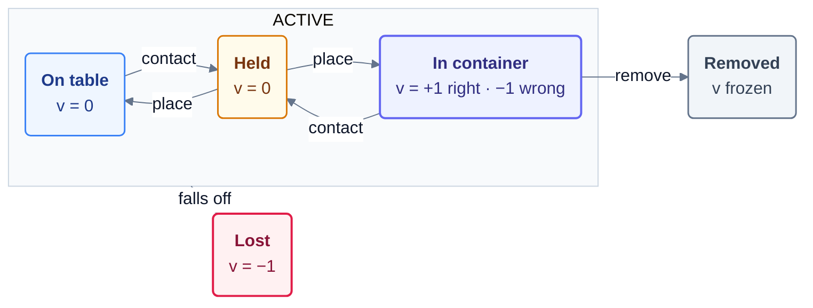
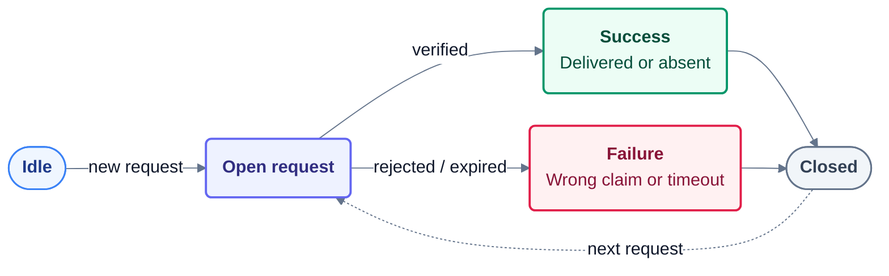

# object_finding_and_organizing_on_messy_desk — scoring and world state machine

Design notes for maintainers and reviewers. The agent-facing rules are in `instruction.md`;
the geometry in `setup/payload/task_card.md`. The code is `setup/payload/messy_desk_env.py`
(the simulator and its state machine) and `setup/payload/messy_desk_score.py` (the score),
both byte-identical copies of the files under `verify/` (this folder).

## Entities

| kind | what | scored |
|---|---|---|
| robot | Franka Panda arm and two-finger gripper | no |
| table | the desk top, the plane z = 0 | no (support surface) |
| container | four KLT containers: gray (class A), light-blue (class B), blue (class C), red (deliveries) | no (they define "in container") |
| target object | the object named by the open request | yes |
| non-target object | every other YCB object in the scene | yes |

## Detectors (every control step, from the simulator's privileged state)

| detector | definition |
|---|---|
| `contact(o)` | PhysX contact report between object `o` and either finger link (summed contact force > 1e-4 N); if the contact view is unavailable, the fallback is centre within 6 cm of the tool centre point |
| `in_container(o)` | the object's centre lies inside a container's interior footprint in that container's own frame (\|x\| ≤ 0.140, \|y\| ≤ 0.109 m) and its height is between the floor − 0.02 and the rim + 0.12 m |
| `on_table(o)` | not inside any container, centre below 0.16 m, placed |
| `resting(o)` | speed < 0.08 m/s |
| `placed(o)` | `resting(o)` and not `contact(o)`: released by the gripper and still |
| `lost(o)` | centre below z = −0.2 m: it left the table |

## Object automaton

Key object states; node values are $v_o(t)$.

“Place” means released and resting. A right container is the class container, or red for the requested object. Removal by container service or confirmed delivery freezes the value; loss keeps −1. Transit ($v=0$), arrivals, disturbances and instance reuse are omitted for clarity.

## Request automaton

Each request closes as a success or failure.

Success means a verified delivery or a correct absence declaration. Both outcomes count toward $N_{\mathrm{success}}$; every closed request counts toward $N_{\mathrm{closed}}$, so $R=N_{\mathrm{success}}/N_{\mathrm{closed}}$. The next request starts a new cycle.

## Score

$$
S = \frac{1}{2}\, O + \frac{1}{2}\, R, \qquad
O = \mathrm{clip}\left( \frac{\sum_{t=1}^{T} \sum_{o} \left( v_o(t) - b_o \right)}{\sum_{t=1}^{T} \sum_{o} \max\left( 0,\, 1 - b_o \right)},\ 0,\ 1 \right), \qquad
R = \frac{N_{\mathrm{success}}}{N_{\mathrm{closed}}}
$$

and when the episode was cut after $T < H$ steps, $S \leftarrow S \cdot T / H$.

| term | meaning |
|---|---|
| $S$ | the episode score in $[0, 1]$; the task metric `mean_episode_score` is its mean over the hidden seeds |
| $O$ | organization: how much of the sorting work that was available over the episode was done, every step counted (anytime) |
| $R$ | requests: the fraction of closed requests that ended in a success |
| $v_o(t)$ | value of object $o$ at step $t$: +1 placed in a right container, −1 placed in a wrong one, 0 on the table / held / in flight, −1 for ever once lost, last value once removed |
| $b_o$ | baseline of object $o$: its value when it entered the scene (0 for an arrival, +1 for an object that starts in its pile) or when the world last moved it (−1 after a misplacement; re-read once a nudged object rests again) |
| $v_o(t) - b_o$ | the agent's net effect on object $o$: untouched objects contribute 0 |
| $\max(0, 1 - b_o)$ | the gain that was available for $o$: 1 per step for a loose object, 2 for one the world misfiled, 0 for one already in place |
| $T$, $H$ | steps actually run and the horizon (20000); an episode the grader cuts for exhausting its wall-clock budget keeps what it earned, scaled by $T/H$ |
| $N_{\mathrm{success}}$, $N_{\mathrm{closed}}$ | requests closed as `delivered` or `absent_correct`, and all closed requests; $R = 0$ when none closed |

Properties: an untouched scene scores exactly 0 (every $v_o = b_o$, no successful request);
holding an object inside a container is not "placed", so it earns nothing; knocking an object
off the table is as bad as misfiling it and cannot be undone; an aborted episode (protocol
error, step deadline, malformed action) scores 0 and stays in the mean. The grader scales the
measured mean by the oracle's anchor and `full_at` (see `verify/anchor.json`); nothing the
controller prints is a scoring input.
