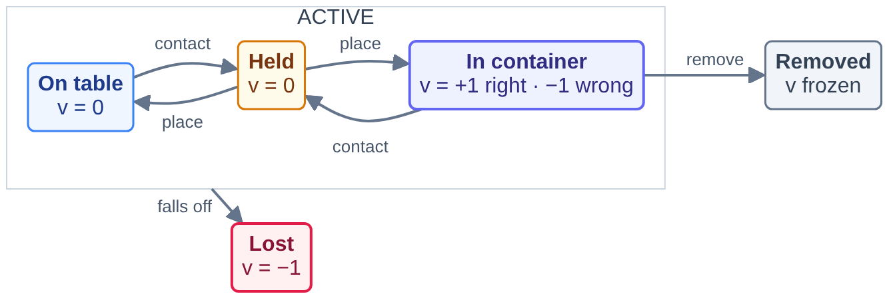
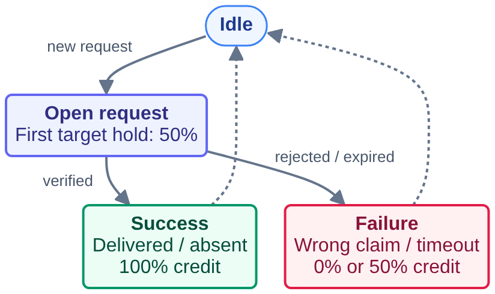

# object_finding_and_organizing_on_messy_desk — scoring and world state machine

Design notes for maintainers and reviewers. The agent-facing rules are in `instruction.md`;
the geometry in `setup/payload/task_card.md`. The code is `setup/payload/messy_desk_env.py`
(the simulator and its state machine) and `setup/payload/messy_desk_score.py` (the score),
both byte-identical copies of the files under `verify/` (this folder).

## Entities

| kind | what | scored |
|---|---|---|
| robot | Franka Panda arm and two-finger gripper | no |
| table | the desk top, the plane z = 0 | no (support surface) |
| container | four KLT containers: gray (class A: boxes and blocks), light-blue (class B: cans and bottles), blue (class C: tools and kitchenware), red (deliveries); the class catalogue is in the task card | no (they define "in container") |
| target object | the object named by the open request | yes |
| non-target object | every other YCB object in the scene | yes |

## Detectors (every control step, from the simulator's privileged state)

| detector | definition |
|---|---|
| `contact(o)` | PhysX contact report between object `o` and either finger link (summed contact force > 1e-4 N); if the contact view is unavailable, the fallback is centre within 6 cm of the tool centre point |
| `in_container(o)` | the object's centre lies inside a container's interior footprint in that container's own frame (\|x\| ≤ 0.140, \|y\| ≤ 0.109 m) and its height is between the floor − 0.02 and the rim + 0.12 m |
| `on_table(o)` | not inside any container, centre below 0.16 m, placed |
| `resting(o)` | speed < 0.08 m/s |
| `placed(o)` | `resting(o)` and not `contact(o)`: released by the gripper and still |
| `lost(o)` | centre below z = −0.2 m: it left the table |

## Object automaton

Key object states; node values are $v_o(t)$. First-hold credit belongs to $R$, not to $v_o(t)$.

  

<!-- Editable source: figures/object-automaton.mmd -->

The first hold of the requested target earns +1 request point once; repeated holds add nothing. “Place” means released and resting. A right container is the class container; while a request is open its object has red as its only right container, and holding it counts +1. Removal by container service or confirmed delivery freezes the value; only falling off the table triggers `Lost` and keeps −1. A release onto the table or into a container is not a loss. Transit ($v=0$), arrivals, disturbances and instance reuse are omitted for clarity.

## Request automaton

Each request earns partial credit on its first target hold, then closes as a success or failure.

  

<!-- Editable source: figures/request-automaton.mmd -->

A first target hold earns +1 point; delivery adds +1 for a total of 2. Correct absence also earns 2 points. Failure or expiry keeps any first-hold credit but adds no completion credit. $R$ divides total request points by twice the number of opened requests, including the ongoing one. The next request starts a new cycle.

## Score

$$
S = \frac{1}{2}\, O + \frac{1}{2}\, R, \qquad
O = \frac{1}{K} \sum_{k=1}^{K} O(t_k), \qquad
O(t) = \mathrm{clip}\left( \frac{\sum_{o} \left( v_o(t) - b_o(t) \right)}{\sum_{o} \max\left( 0,\, 1 - b_o(t) \right)},\ 0,\ 1 \right), \qquad
R = \frac{\sum_{j=1}^{N_{\mathrm{opened}}} q_j}{2N_{\mathrm{opened}}}
$$

where $q_j = 2$ for a verified delivery or correct absence declaration, $q_j = 1$
for a request whose target was held at least once but has not been successfully completed,
and $q_j = 0$ otherwise. Repeated holds do not accumulate credit. $R = 0$ when no request
has opened. A first hold is recorded only while the request is open and its target is
currently in `held` state; historical contacts do not count.

where $t_1, \dots, t_K$ are the steps at which a request closes (its mark or its deadline) and
the episode's last step $T$: each request is a task, find plus organize, judged with the desk
when it closes. When the grader cuts an episode for exhausting its wall-clock budget,
$S \leftarrow S \cdot T / H$.

| term | meaning |
|---|---|
| $S$ | the episode score in $[0, 1]$; the task metric `mean_episode_score` is its mean over the hidden seeds |
| $O$ | organization: the mean of the snapshots $O(t_k)$, how much of the sorting work the episode has brought (every object ever in the scene) is done when each request closes and at the last step |
| $R$ | request progress: total points divided by twice the number of opened requests, including an ongoing one |
| $v_o(t)$ | value of object $o$ at step $t$: +1 placed in its class container, −1 placed in another one, 0 on the table / held / in flight; while a request is open its object belongs to the red container only (+1 placed in red or held, −1 in any other container, 0 on the table or in flight); −1 for ever once lost, last value once removed |
| $b_o(t)$ | baseline of object $o$: its value when it entered the scene (0 for an arrival, +1 for an object that starts in its pile), when a request named it (its red-only value then; the previous baseline returns after the request closes), or when the world last moved it (−1 after a misplacement; re-read once a nudged object rests again) |
| $v_o(t) - b_o(t)$ | the agent's net effect on object $o$: untouched objects contribute 0 |
| $\max(0, 1 - b_o(t))$ | the gain that was available for $o$: 1 for a loose object, 2 for one the world misfiled, 0 for one already in place |
| $t_k$, $K$ | the steps at which a request closes plus the last step $T$, and their number (5 in a full episode) |
| $T$, $H$ | the episode's last step and the horizon (20000); an episode the grader cuts for exhausting its wall-clock budget is scaled by $T/H$ |
| $q_j$, $N_{\mathrm{opened}}$ | points for request $j$ (0, 1, or 2), and the number of requests opened; $R = 0$ when none opened |

Properties: an untouched scene scores exactly 0 (every $v_o = b_o$, no successful request);
holding an object inside a container is not "placed", so it earns no organization credit;
the first target hold can still earn request credit; knocking an object
off the table is as bad as misfiling it and cannot be undone; an aborted episode (protocol
error, step deadline, malformed action) scores 0 and stays in the mean. The grader scales the
measured mean by the oracle's anchor and `full_at` (see `verify/anchor.json`); nothing the
controller prints is a scoring input.
