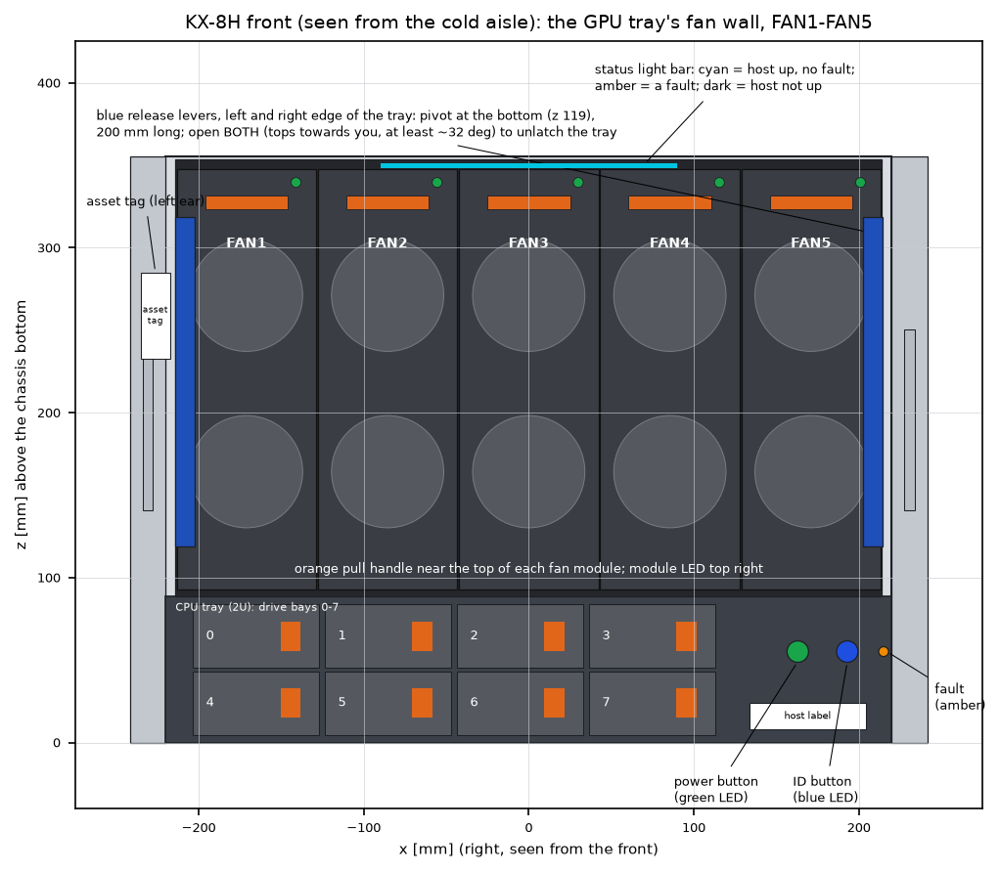
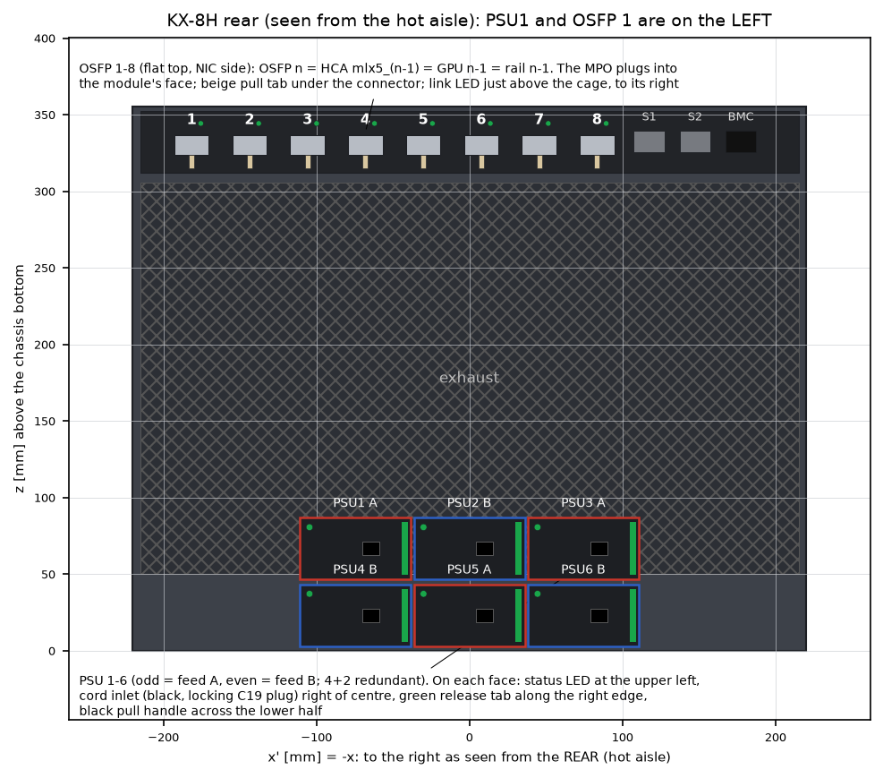
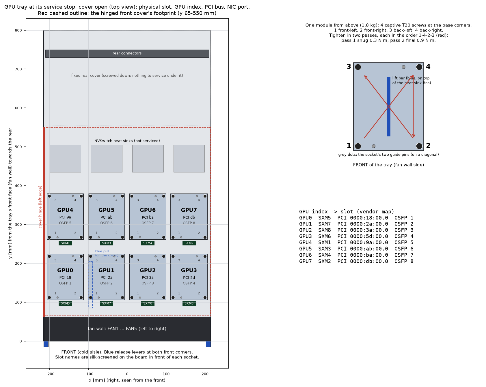

# KESTREL KX-8H GPU node: service guide (site edition for DC1)

Kestrel Systems' service guide for the KX-8H 8-GPU node, edition for sites with certified field technicians: besides
the customer-replaceable units (fan modules, power supplies, power cords, network transceivers), certified technicians
may reseat and replace the SXM GPU modules. The GPU baseboard and the GPU tray are replaced by Kestrel only (open a
vendor escalation, see the site's SOP-GPU-01).

## 1. Specifications

| item | value |
|---|---|
| form factor | 8U rack-mount, 440 mm wide (482.6 mm with the mounting ears), 897 mm deep, 355.6 mm high |
| layout | lower 2U: CPU tray (CPUs, memory, 8 U.2 drive bays, front control panel); upper 6U: GPU tray (8 GPU modules on the GPU baseboard, NVSwitch, the front fan wall) |
| GPU | 8 x SXM-H8-80G modules (80 GB HBM each), in two rows of four |
| cluster network | 8 x OSFP 400G (NDR) ports at the rear, one per GPU (port n = GPU n-1), multimode OSFP-400G-SR4 transceivers (flat top) |
| other rear ports | 2 storage ports (S1, S2), BMC RJ45 |
| power | 6 x 3.3 kW hot-swap supplies KX-PS3300, 4+2 redundant, two feeds (PSU1/3/5 feed A, PSU2/4/6 feed B), locking C19 inlet cords |
| power draw | about 10.2 kW at full GPU load, about 1.0 kW idle with the host up, about 50 W in standby (BMC only) |
| cooling | 5 hot-swap dual-rotor fan modules KX-FAN80D in the GPU tray's front (its fan wall, open to the aisle: no bezel); 12,000 RPM per rotor at speed |
| management | BMC: power control, system event log (SEL), sensors, FRU inventory, identify LED |

## 2. Front, rear and the drawing frame

**Drawing frame** (all mm): origin at the middle of the chassis' front bottom edge (the front face of the chassis,
behind the ears); **x to the right as seen from the front**, y into the chassis (front to rear), z up.
In a DC1 rack the chassis bottom is the bottom of U8 and the front face is the plane of the front mounting rails
(0.100 m behind the rack's front edge, U8's bottom 0.41115 m above the floor), so a drawing point (x, y, z) in mm is
at (x / 1000, 0.100 + y / 1000, 0.41115 + z / 1000) m in the rack's frame (the DCIM rack frame: origin at the middle
of the rack's front edge on the floor, x to the right of a person facing the rack's front, y into the rack, z up). As
seen from the rear, x runs from right to left: PSU1 and OSFP 1 are on the left.

Front (no bezel: the GPU tray's fan wall and its two release levers are open to the aisle; the fan modules' faces are
10 mm before the chassis face):

| feature (front) | x [mm] | z [mm] | note |
|---|---|---|---|
| power button with green LED (centre) | 163 | 55 | button 13 mm diameter |
| ID button with blue LED (centre) | 193 | 55 | button 13 mm diameter |
| fault LED (amber) | 215 | 55 |  |
| host label (70 x 16 mm, centre) | 169 | 16 | host name, model, chassis serial |
| drive bays 0-3 / 4-7 (centres) | -166, -86, -6, 75 | 65 / 24 | U.2, not serviced on shift |
| CPU tray / GPU tray (height ranges) | -220 .. 220 | 0-89 / 89-356 | the GPU tray is the upper 6U |
| status light bar (centre) | 0 | 350 | 180 mm long, across the chassis above the fan wall |
| asset tag (18 x 52 mm upright, centre) | -226 | 259 | on the left ear beside the fan wall; asset number and bar code |
| release levers, left / right (pivot) | -208.5 / 208.5 | 119 | 200 mm long, 12 wide, 4 mm before the tray face; open = top towards you |
| FAN1 module face (centre) | -171 | 220 | 84.5 x 254.7 mm; orange handle across the face at z 328; LED at x -141, z 340 |
| FAN2 module face (centre) | -86 | 220 | 84.5 x 254.7 mm; orange handle across the face at z 328; LED at x -55, z 340 |
| FAN3 module face (centre) | 0 | 220 | 84.5 x 254.7 mm; orange handle across the face at z 328; LED at x 30, z 340 |
| FAN4 module face (centre) | 86 | 220 | 84.5 x 254.7 mm; orange handle across the face at z 328; LED at x 115, z 340 |
| FAN5 module face (centre) | 171 | 220 | 84.5 x 254.7 mm; orange handle across the face at z 328; LED at x 201, z 340 |

Rear (the chassis' rear face is at y = 897):

| feature (rear) | x [mm] | z [mm] | note |
|---|---|---|---|
| PSU1 bay, feed A (face centre) | 75 | 67 | face 71 x 40.5 mm, 3 mm behind the chassis rear; cord inlet at x 64; LED at x 105, z 81 |
| PSU2 bay, feed B (face centre) | 0 | 67 | face 71 x 40.5 mm, 3 mm behind the chassis rear; cord inlet at x -10; LED at x 30, z 81 |
| PSU3 bay, feed A (face centre) | -75 | 67 | face 71 x 40.5 mm, 3 mm behind the chassis rear; cord inlet at x -85; LED at x -44, z 81 |
| PSU4 bay, feed B (face centre) | 75 | 23 | face 71 x 40.5 mm, 3 mm behind the chassis rear; cord inlet at x 64; LED at x 105, z 37 |
| PSU5 bay, feed A (face centre) | 0 | 23 | face 71 x 40.5 mm, 3 mm behind the chassis rear; cord inlet at x -10; LED at x 30, z 37 |
| PSU6 bay, feed B (face centre) | -75 | 23 | face 71 x 40.5 mm, 3 mm behind the chassis rear; cord inlet at x -85; LED at x -44, z 37 |
| OSFP 1 cage (HCA mlx5_0) | 182 | 330 | a seated transceiver's face (its MPO receptacle) stands 30 mm out of the cage; link LED at x 176, z 344 |
| OSFP 2 cage (HCA mlx5_1) | 144 | 330 | a seated transceiver's face (its MPO receptacle) stands 30 mm out of the cage; link LED at x 138, z 344 |
| OSFP 3 cage (HCA mlx5_2) | 106 | 330 | a seated transceiver's face (its MPO receptacle) stands 30 mm out of the cage; link LED at x 100, z 344 |
| OSFP 4 cage (HCA mlx5_3) | 68 | 330 | a seated transceiver's face (its MPO receptacle) stands 30 mm out of the cage; link LED at x 62, z 344 |
| OSFP 5 cage (HCA mlx5_4) | 30 | 330 | a seated transceiver's face (its MPO receptacle) stands 30 mm out of the cage; link LED at x 24, z 344 |
| OSFP 6 cage (HCA mlx5_5) | -8 | 330 | a seated transceiver's face (its MPO receptacle) stands 30 mm out of the cage; link LED at x -14, z 344 |
| OSFP 7 cage (HCA mlx5_6) | -46 | 330 | a seated transceiver's face (its MPO receptacle) stands 30 mm out of the cage; link LED at x -52, z 344 |
| OSFP 8 cage (HCA mlx5_7) | -83 | 330 | a seated transceiver's face (its MPO receptacle) stands 30 mm out of the cage; link LED at x -89, z 344 |

## 3. Field-replaceable units

| unit | model | where | replacement |
|---|---|---|---|
| fan module | KX-FAN80D | front, the GPU tray's fan wall, bays FAN1-FAN5 from the left | hot swap, at most 30 s per bay (section 10) |
| power supply | KX-PS3300 | rear, bays PSU1-PSU6 in two rows of three (PSU1-3 on top), each row from the left as seen from the rear | hot swap, at least four other supplies OK, at most 30 s per bay (section 11) |
| power cord | C20 to C19, 16 A, locking | each supply's inlet to the rack PDU | hot swap of a cord whose supply is not needed (section 11) |
| transceiver | OSFP-400G-SR4 | rear, OSFP cages 1-8 | hot-pluggable; the link is down while it is out (osfp_mpo_guide.md) |
| GPU module | SXM-H8-80G | GPU tray, slots SXM1-SXM8 | host off **and AC removed**, tray at its service stop (sections 8, 9) |
| GPU baseboard, GPU tray, CPU tray parts, U.2 drives | - | - | not on shift: vendor or other procedures |

## 4. LEDs

| LED | where | state and meaning |
|---|---|---|
| power (green, in the power button) | front control panel | steady: host up (also while it shuts down); blinking fast (4 Hz): POST and boot in progress; blinking slow (1 Hz): standby (AC present, host off); dark: no AC (no working supply has AC) |
| ID (blue, in the ID button) | front control panel | steady: identify on; blinking (2 Hz): identify blink; dark: off (also whenever the BMC is without power) |
| fault (amber) | front control panel | lit while any fault is asserted: a supply failed or without AC; a fan module failed or degraded (host up); a GPU missing or failing (host up); GPU thermal slowdown; power brake; POST error; GPU tray not latched |
| status light bar | front, across the chassis above the fan wall | cyan: host up, no fault; amber: host up with a fault asserted; dark: host not up |
| supply LED | each supply's face, upper left | green: output OK; amber: supply failed (it has AC but no output); dark: no AC at the supply (cord, outlet) |
| fan module LED | each module's face, upper right | green: OK; amber: failed or degraded (a rotor slow or stopped); dark: host not up, or no module |
| link LED | above each OSFP cage, to its right (as seen from the rear) | green: link up, no symbol errors in the last 60 s; amber: link flapping, or symbol errors in the last 60 s; blinking blue (2 Hz): port locate on; dark: link down |

## 5. Power

**Supplies and redundancy.** Each supply delivers 3.3 kW. The node runs at full power on any four good supplies
(supplies share the load evenly). With only three good supplies the BMC asserts the **power brake**: the GPUs' power is
capped and they slow down. With two or fewer good supplies the host cannot be kept up: it powers off (standby). The host
can only be powered on with at least three good supplies. The BMC reports each supply as `ok`, `failure` (it has AC but
has failed), `ac_lost` (no AC at its inlet) or `absent`, and the redundancy as `full` (6 OK), `degraded` (4 or 5 OK) or
`lost` (3 or fewer OK).

**Power states.**

| state | meaning | how it is left |
|---|---|---|
| no AC | no working supply has AC: everything is off, the BMC too | AC returns: the BMC starts at once, the host stays off (standby) |
| standby | AC present, BMC up, host off | power on: booting |
| booting | POST and OS boot, about 5 min | the host is up (on) |
| on | the host is up | graceful shutdown (up to 90 s) or forced off |
| shutting down | graceful shutdown, up to 90 s | standby |

* **Power on** (BMC `on`): from standby only; refused while a graceful shutdown runs. POST stops with "POST error: GPU
  tray not seated" (the host stays in standby, fault LED on) if the GPU tray is not home and latched.
* **Graceful off** (BMC `off`): the OS shuts down, then standby. **Forced off** (BMC `forceoff`): the host stops at
  once; use it only when a graceful shutdown hangs.
* **Power cycle** (BMC `cycle`): graceful off, 10 s, power on. It does **not** remove AC: the GPU baseboard's standby
  domain stays powered.
* **Cold reset.** A GPU that has fallen off the bus can only be brought back by removing AC from the whole node: switch
  off the PDU outlets of all six supplies (with the host off) and keep them off for **at least 30 s**; then restore them
  and power the host on.
* **AC policy.** After AC returns the host stays off until it is powered on.
* The power button does not remove AC. Before opening the GPU tray, remove AC at the PDU.

## 6. BMC

The BMC is reached over the rack's management network (`<host>-bmc`); it runs on standby power whenever at least one
working supply has AC. The site services expose it as `bmc.power_state`, `bmc.power`, `bmc.sel`, `bmc.sensors`,
`bmc.fru` and `bmc.identify` (site/services_api.md).

**System event log (SEL).** Each entry: `id`, `time` (seconds on the site's shift clock, negative before the shift),
`timestamp` (UTC), `sensor`, `event`, `severity` (`info`, `warning`, `critical`). The SEL records only while the BMC
has power. Entries you will meet:

| sensor | events |
|---|---|
| `System ACPI Power State` | `S0/G0: working (host power on)`, `Host power on: POST started`, `S5/G2: host soft-off`, `Host power off (forced)`, `Host power lost: <n> of 6 PSUs OK`, `Host power cycle (BMC)` |
| `System Event` | `Power on requested (BMC)`, `Graceful shutdown requested (BMC)`, `Power cycle requested (BMC)`, `OS boot completed`, `AC power restored: BMC started` |
| `System Firmware Progress` | `POST error: GPU tray not seated` |
| `GPU<i> (<PCI address>)` | `Xid 79: GPU has fallen off the bus`, `Xid 64: row remapping failure`, `Xid 48: uncorrectable double-bit ECC error (DBE) in framebuffer`, `Not detected on PCIe (link training failed)` (at boot), `Xid 64: row remapping failure (pending at init)` (at boot) |
| `PSU<n> Status` | `Failure detected`, `AC input lost`, `AC input restored`, `Presence deasserted (removed)`, `Presence detected (inserted)`, `Presence detected, output OK` |
| `Power Unit Redundancy` | `Fully redundant (6 of 6 PSUs OK)`, `Redundancy degraded (<n> of 6 PSUs OK)`, `Redundancy lost (<n> of 6 PSUs OK)`, `Power brake asserted: GPUs capped (3 of 6 PSUs OK)`, `Power brake deasserted`, `Power on denied: insufficient PSU capacity (<n> of 6 OK)` |
| `FAN<n>`, `FAN<n>_F`, `FAN<n>_R` (module, front and rear rotor) | `Fan failure: 0 RPM`, `Lower critical going low: 0 RPM`, `Rotor below lower non-critical threshold`, `Lower non-critical going low: <rpm> RPM`, `Fan module removed`, `Fan module inserted, speed normal`, `Speed normal` |
| `GPU Thermal` | `GPU thermal slowdown asserted (hottest GPU <t> C)`, `GPU thermal slowdown deasserted`, `GPU over-temperature (<t> C): thermal shutdown` |
| `Chassis Intrusion` | `GPU tray: not seated`, `GPU tray: seated`, `GPU tray removed while powered: host power lost` |
| `Identify` | `Chassis identify LED on`, `... off`, `... blink`, `Chassis identify LED on (force)` |

**Sensors** (`bmc.sensors`): power state, inlet temperature, node power, each GPU's temperature by GPU index (`na`
when the GPU is not on the bus or the host is not up), each fan rotor's speed and each module's status (`ok`,
`degraded`, `failed`, `absent`; `standby` when the host is not up), each supply's status, the redundancy, the power
brake, GPU thermal slowdown, and whether the GPU tray is seated.

**FRU inventory** (`bmc.fru`): the serial number of each supply and fan module in its bay, of each GPU by GPU index
(only while the host is up and that GPU is on the bus), and of each OSFP transceiver (host up).

**Identify.** `on`, `off` or `blink` lights the blue ID LED at the front to mark the node for someone on the floor.
Switch it off when the work is done.

## 7. GPUs

### 7.1 GPU index, PCI address and physical slot

The GPU index used by the driver, the BMC and DCGM is **not** the slot number on the baseboard. Map it with this table:

| GPU index (driver, BMC, DCGM) | PCI address | physical slot | position in the tray (seen from the front) | NIC port / HCA / rail | leaf switch |
|---|---|---|---|---|---|
| GPU0 | 0000:18:00.0 | SXM5 | front row, 1 of 4 from the left | OSFP 1 / mlx5_0 / rail 0 | leaf-a01-1 |
| GPU1 | 0000:2a:00.0 | SXM7 | front row, 2 of 4 from the left | OSFP 2 / mlx5_1 / rail 1 | leaf-a01-2 |
| GPU2 | 0000:3a:00.0 | SXM8 | front row, 3 of 4 from the left | OSFP 3 / mlx5_2 / rail 2 | leaf-a01-3 |
| GPU3 | 0000:5d:00.0 | SXM6 | front row, 4 of 4 from the left | OSFP 4 / mlx5_3 / rail 3 | leaf-a01-4 |
| GPU4 | 0000:9a:00.0 | SXM1 | back row, 1 of 4 from the left | OSFP 5 / mlx5_4 / rail 4 | leaf-b01-1 |
| GPU5 | 0000:ab:00.0 | SXM3 | back row, 2 of 4 from the left | OSFP 6 / mlx5_5 / rail 5 | leaf-b01-2 |
| GPU6 | 0000:ba:00.0 | SXM4 | back row, 3 of 4 from the left | OSFP 7 / mlx5_6 / rail 6 | leaf-b01-3 |
| GPU7 | 0000:db:00.0 | SXM2 | back row, 4 of 4 from the left | OSFP 8 / mlx5_7 / rail 7 | leaf-b01-4 |

The slots as they sit in the tray (front row nearest the fans):

| slot | GPU index | PCI address | row | column (from the left, seen from the front) |
|---|---|---|---|---|
| SXM5 | GPU0 | 0000:18:00.0 | front | 1 |
| SXM7 | GPU1 | 0000:2a:00.0 | front | 2 |
| SXM8 | GPU2 | 0000:3a:00.0 | front | 3 |
| SXM6 | GPU3 | 0000:5d:00.0 | front | 4 |
| SXM1 | GPU4 | 0000:9a:00.0 | back | 1 |
| SXM3 | GPU5 | 0000:ab:00.0 | back | 2 |
| SXM4 | GPU6 | 0000:ba:00.0 | back | 3 |
| SXM2 | GPU7 | 0000:db:00.0 | back | 4 |

Slot centres in the tray frame (origin at the middle of the tray's front face, at the tray floor; x to the right seen
from the front, y towards the rear; the tray floor is 88.9 mm above the chassis bottom; with the tray at its service
stop the tray frame is 740 mm further out than with the tray home):

| slot | GPU index | x [mm] | y [mm] from the tray's front face |
|---|---|---|---|
| SXM5 | GPU0 | -159 | 165 |
| SXM7 | GPU1 | -53 | 165 |
| SXM8 | GPU2 | 53 | 165 |
| SXM6 | GPU3 | 159 | 165 |
| SXM1 | GPU4 | -159 | 320 |
| SXM3 | GPU5 | -53 | 320 |
| SXM4 | GPU6 | 53 | 320 |
| SXM2 | GPU7 | 159 | 320 |

### 7.2 Xid events (driver)

| Xid | meaning | field action |
|---|---|---|
| 79 | GPU has fallen off the bus: the GPU stopped answering on PCIe and the driver lost it | the site's SOP-GPU-01 order: SEL, cold reset, diagnostics, reseat, slot swap, replace or escalate |
| 48 | uncorrectable double-bit ECC error (DBE) in the GPU's memory | reset (cold), then DCGM level 2 or 3 |
| 64 | the row remapper failed to remap a row (no spare row left / uncorrectable) | reset (cold), then DCGM level 2 or 3; a confirmed "HBM row remap failure" means the module is replaced |

### 7.3 DCGM diagnostics

| level | takes about | checks | fails on |
|---|---|---|---|
| 1 (quick) | 3 s | deployment: every GPU present on the bus, driver | a GPU not found on the PCI bus |
| 2 (medium) | 10 min | + memory tests, ECC, row-remap validation | + an HBM row remap failure |
| 3 (long) | 30 min | + targeted stress and targeted power at full load | + clocks throttled by thermal slowdown, or power capped by the power brake, during the run |

A diagnostic runs only with the host up and the node out of the job; it loads the GPUs (the node's power and heat
rise while it runs); it aborts if the host shuts down or loses power. The result lists each GPU by index with `pass` or
`fail` and a message.

## 8. Thermal

| item | value |
|---|---|
| inlet air (DC1 cold aisle) | 22-25 C |
| hottest GPU under the training load, healthy fans | about 75-82 C |
| GPU thermal slowdown | asserted above 87 C (clocks are reduced to hold 87 C); deasserted below 85 C |
| GPU over-temperature shutdown | 95 C: the host powers off (standby) |
| one fan module failed (both rotors stopped) | under full load the GPUs reach the slowdown temperature: the node throttles |
| one fan bay empty | the air short-circuits through the open bay: under load the node reaches the shutdown temperature within about a minute |
| one rotor of a module slow (module `degraded`) | stays below the slowdown temperature; BMC warning only |

The back row of GPU modules runs a few degrees warmer than the front row (it takes the front row's air).

## 9. GPU tray service (removing AC is mandatory)

The GPU tray slides out to the front on rails. **Before the tray moves:** the host off at the BMC (standby), then AC
removed from all six supplies at the PDU, the power LED dark. Pulling the tray with the host up destroys the GPU
modules' connectors; pulling it with AC present is forbidden by the site. **Extend only one tray in the pod at a
time.**

1. **Levers.** Open both blue release levers at the tray's left and right front edges: their tops swing towards you
   (they open to about 50 deg; the tray unlatches when both are past about 30 deg).
2. **Pull.** Pull the tray straight out by its levers to full extension, the service position (740 mm travel). There
   the rails lock at their service stop: a bump does not push the tray back in.
3. **Fold the levers** back flat against the tray face once the tray is out: open levers stick out into the aisle.
4. **Cover.** The tray's top has two covers: a fixed rear cover over the baseboard's rear connectors (screwed down,
   not a field part) and the **hinged front cover**, 485 mm long, over the GPU modules and the NVSwitches. The front
   cover is hinged along the tray's left top edge (tray frame x = -214 mm, 263 mm above the tray floor, from y = 65
   to 550 mm) and is opened from the tray's front: lift it by its blue pull, near its front-left corner (a bar on the
   cover along y, about 120 mm from the hinge, from y = 85 to 205 mm), past vertical, until it rests on its stay at
   about 110 deg. (Closing: grip the cover, which frees the stay, and lower it until it lies flat.) Its service label
   repeats the slot map (the front row, SXM5 / SXM7 / SXM8 / SXM6, at the bottom next to FRONT) and the screw
   numbering.
6. Work on the modules (section 9.1).
6. **Close.** Lower the cover. Hold either lever (holding a lever frees the rails from the service stop) and push the
   tray home by its levers until it is fully in; close both levers flat against the tray face: the tray latches.
   Restore AC and power the host on; the BMC reports the tray `seated`, and POST fails if it is
   not.

### 9.1 GPU module removal and installation

The module (1.8 kg) is held on its socket by four captive T20 screws at the corners of its base, at the bottom of
wells in the heat sink: use the long-reach T20 driver (its bit tip about 190 mm below the handle), square to the
screw. Screw numbering, seen from above: **1 front-left, 2 front-right, 3 back-left, 4 back-right** ("front" =
towards the fan wall). Two guide pins on the socket, on a diagonal, locate the module; the blue lift bar along the top
of the heat sink is the handle. The module has no latch: once its screws are out it sits on its pins by its weight.

| module feature | position (tray frame, relative to the slot centre of section 7.1) |
|---|---|
| base | 94 mm (x) by 118 mm (y), its underside 5.4 mm above the tray floor, 10 mm thick |
| heat sink fins | on the base, up to 110 mm above the tray floor |
| lift bar (blue) | along y from -40 to +40 mm, its axis 133 mm above the tray floor, 11 mm thick |
| screws 1 / 2 / 3 / 4 | at (x, y) = (-41, -53) / (+41, -53) / (-41, +53) / (+41, +53) mm; head 8.4 mm across, its top 21 mm above the tray floor when fastened, rising 0.5 mm per turn as it is run out (3 mm when free) |
| guide pins (on the socket) | two, on a diagonal at (x, y) = (-20, -53) and (+20, +53) mm, 15 mm tall |
| slot name | silk-screened on the board just in front of the module's front edge |

**Removal.** Run all four screws out (loosen until free: about 6 turns each; they stay captive in the module). Take
the lift bar and lift deliberately, **straight up**: the module comes off the socket and rides 15 mm up its guide
pins, after which it is free; make no other motion before it is clear of the pins. The module does not come up while
any screw is still engaged.

**Installation.** Hold the module level and square over the socket, lower it onto the guide pins (it enters them when
aligned within about 1.5 mm and 2 deg) and set it down: it seats on the socket by its own weight, no push needed.
Never press a module down that does not drop onto its pins: a module forced down misaligned bends the socket's pins
(the slot is then damaged). Fasten:

| pass | order | torque (driver clutch setting) |
|---|---|---|
| 1, snug | 1, 4, 2, 3 | 0.3 N m |
| 2, final | 1, 4, 2, 3 | 0.9 N m |

* Start with a diagonal pair (1 and 4, or 2 and 3): a module whose first two screws are not diagonal seats unevenly
  and its GPU is not detected.
* Never torque a screw beyond snug while any other screw of that module is still out: the module tilts and bends the
  socket's pins.
* A module counts as fastened only when all four screws are at the final torque.

## 10. Fan module replacement (hot swap)

The modules sit in the GPU tray's fan wall at the node's front, FAN1 to FAN5 from the left. A module is released by
gripping its orange handle (the grip opens its latch) and pulling straight out; a module is installed by pushing it
square into the bay until it latches. **On a running node a bay may stay empty for at most 30 s**: have the new
module in hand before you pull the old one. Two rotors per module (`_F` front, `_R` rear) at about 12,000 RPM each.

## 11. Power supply and cord replacement (hot swap)

* **Before** removing a supply from a running node: at least four **other** supplies must be OK (green). Never remove a
  green supply or its cord from a running node.
* The supply's cord must be out of the inlet before the supply can be pulled (the inlet's cord lock blocks the
  supply's latch).
* Removal: grip the black pull handle (the grip presses the green release tab) and pull the supply straight out.
  Installation: push the supply square into the bay until it latches, then plug the cord in until its lock latches.
  **A bay of a running node may stay empty for at most 30 s.**
* A supply that shows `ac_lost` while its PDU outlet is on has no contact through its cord: reseat the cord at the
  supply's inlet (pull the plug straight out, push it fully back in until it latches).
* Replace a supply only with the same model (KX-PS3300).

## 12. Handling data

| part | mass [kg] | guided travel [mm] | enters its slot when aligned within | latch releases at a straight pull above [N] | latches at a push above [N] | misaligned and pushed harder than this, it damages the slot [N] |
|---|---|---|---|---|---|---|
| fan module KX-FAN80D | 0.55 | 62 | +/- 1.5 mm, 3 deg | 8 | 12 | 40 |
| power supply KX-PS3300 | 1.10 | 190 | +/- 1.5 mm, 3 deg | 8 | 15 | 45 |
| power cord plug (C19, locking) | 0.12 | 12 | +/- 1.2 mm, 4 deg | 10 | 20 | 60 |
| transceiver OSFP-400G-SR4 (node, flat top) | 0.06 | 72 | +/- 0.8 mm, 3 deg | 6 | 18 | 28 |
| transceiver OSFP-400G-SR4-F (leaf, finned) | 0.08 | 72 | +/- 0.8 mm, 3 deg | 6 | 18 | 28 |
| MPO-12 connector (fibre) | 0.02 | 8 | +/- 0.5 mm, 3 deg | 5 | 10 | 25 |
| GPU module SXM-H8-80G | 1.80 | 15 | +/- 1.5 mm, 2 deg | lift above 3 (screws out) | - (seats by its weight on its pins) | 60 |

* Move every part along its slot's axis (straight in, straight out); the slot guides it over the travel shown.
* A latched part lets go after a steady pull above its release force (held for a moment, about 50 ms; it gives a few
  millimetres first); a part pushed home clicks into its latch with a push above its latch force.
* A part that does not slide in has met its slot misaligned: back it out and realign, do not push harder.
* The transceiver's MPO connector must be out before the transceiver can be pulled; the supply's cord before the
  supply; all four screws before a GPU module.
