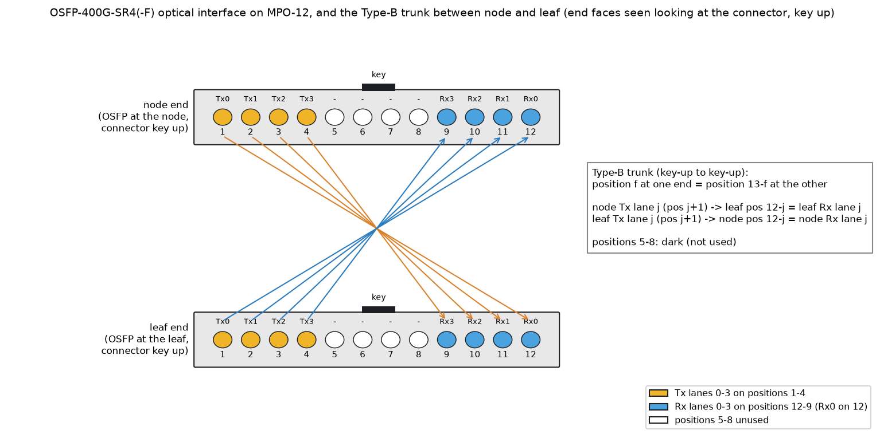
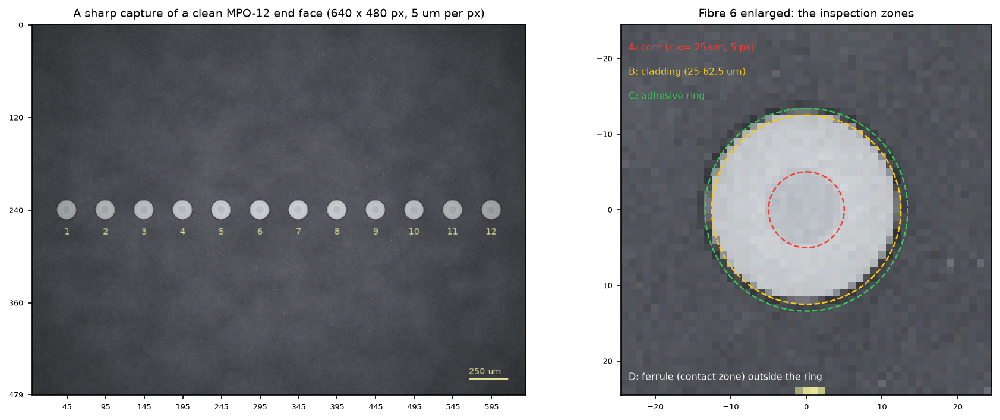
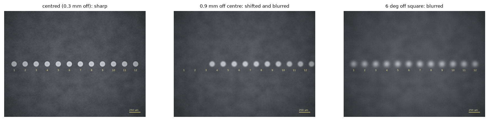
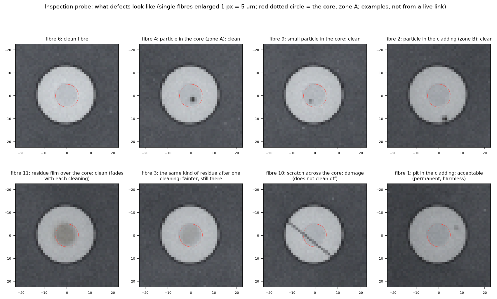

# OSFP 400G SR4 transceivers and MPO-12 trunks: data sheet and field guide (site edition)

For the optical links between the KX-8H nodes and the leaf switches: the transceivers at both ends, the MPO-12 trunk
between them, the digital diagnostics (DDM), end-face inspection with the site's probe, cleaning with the one-click
cleaner, and handling. The site's procedure for a bad link is SOP-NET-01.

## 1. Parts

| part | model | where | notes |
|---|---|---|---|
| node transceiver | OSFP-400G-SR4 | KX-8H rear, OSFP cages 1-8 | flat top (the node's cage carries the heat sink); beige pull tab (multimode) |
| leaf transceiver | OSFP-400G-SR4-F | leaf switch ports | finned top; beige pull tab |
| trunk | MPO12-APC-OM4 | node port to leaf port | 12-fibre MPO connector at each end, OM4 multimode, aqua jacket, **Type-B** polarity; 7 m within a row, 10 m to the other row; the same label at both ends (`<node rack>-08:<port>/<leaf rack>-<U>:<port>`) |

Both transceivers: 400 Gb/s (NDR), four optical lanes per direction at 850 nm over multimode fibre (100 Gb/s each),
one MPO-12 receptacle (eight of the twelve fibres used), digital diagnostics per lane. The two models differ in their
top (heat sink) and do not fit each other's cages: replace like with like.

## 2. Optical interface: lanes, fibre positions, polarity

Fibre positions are numbered 1 to 12 across the connector, seen looking at its end face with the key up.

| positions | use |
|---|---|
| 1, 2, 3, 4 | transmit lanes 0, 1, 2, 3 (Tx lane j on position j + 1) |
| 5-8 | dark (not used) |
| 12, 11, 10, 9 | receive lanes 0, 1, 2, 3 (Rx lane j on position 12 - j: position 12 is Rx lane 0) |

The trunk is **Type-B** (key-up to key-up): position f at one end arrives at position 13 - f at the other. So:

| near end's receive lane r | its fibre position at the near end | position at the far end | fed by the far end's transmit lane |
|---|---|---|---|
| 0 | 12 | 1 | 0 |
| 1 | 11 | 2 | 1 |
| 2 | 10 | 3 | 2 |
| 3 | 9 | 4 | 3 |

In words: receive lane r at one end is fed by transmit lane r of the other end (lane n reaches lane n); the light
leaves the far end on position r + 1 and arrives at the near end on position 12 - r. Light on a fibre passes four end
faces: the far module's receptacle and the far connector (position r + 1), then the near connector and the near
module's receptacle (position 12 - r). The same applies in both directions (node to leaf and leaf to node).

## 3. Digital diagnostics (DDM)

The fabric manager reads each module's diagnostics (`fabric.ddm`): the module's model, serial, case temperature and
supply voltage, and per lane the transmit power (`tx_dbm`), the received power (`rx_dbm`) and the laser bias current
(`bias_ma`), with the module's warning and alarm flags. A node-side module is read through its host (host up); a
leaf-side module through its switch. The received power of a lane is only meaningful while the far end is powered and
transmitting.

| quantity (per lane) | value |
|---|---|
| transmit power, new module | 0.0 dBm typical (within about +/- 0.5 dBm) |
| laser bias, new module | 7.0 mA typical (6.5-7.5 mA) |
| laser bias warning (`tx_bias_high`) | above 10.0 mA: the laser needs more current for its light (end of life); its transmit power drops |
| receiver sensitivity | -6.0 dBm: below it the lane cannot hold lock; the link flaps (drops for a few seconds, comes back) and, about 2 dB lower, stays down |
| received power for error-free operation | at least -5.0 dBm: between -5.0 and -6.0 dBm the lane runs but leaves symbol errors after FEC |
| receive power warning (`rx_power_low`) | below -6.0 dBm |
| loss of signal alarm (`rx_los`) | no light at all (far end off or unplugged, fibre out, module not seated) |
| case temperature | node side typically 49-56 C, leaf side 40-47 C; operating range 0-70 C |
| supply voltage | 3.3 V +/- 5 % |

**Link budget.** A clean installed trunk with its two mated connections loses about 2.0-2.4 dB on every fibre: a
healthy lane receives about -2.0 to -2.5 dBm. Each contaminated or damaged end face along a fibre adds its own loss on
that fibre only: a particle or a residue film over the core typically costs from a few tenths of a dB to more than a
dB, a scratch across the core several dB; contamination outside the core costs very little.

**Reading the evidence.** For a weak receive lane r at one end, read the far end's transmit lane r:

* the far end's transmit power on that lane clearly below its other lanes, with its bias above 10 mA: the far module's
  laser is failing; its own receive lanes are normal;
* the far end's transmit power normal: the light is lost on the way: one of the four faces on that fibre (section 2)
  is contaminated or damaged.

## 4. Link counters and thresholds

| counter (`fabric.port`) | meaning |
|---|---|
| `symbol_errors` | symbol errors after FEC at this port's receiver since the counters were cleared (or, on a node, since the host booted) |
| `link_down_count` | times the link went down since the counters were cleared |
| `effective_ber` | symbol errors / bits carried since the counters were cleared |
| `raw_ber` | the receiver's current pre-FEC bit error ratio estimate (worst lane) |

The fabric manager raises event 916 "High Symbol BER" when a port's effective symbol BER exceeds 1e-16 (in practice:
any symbol error), and reports a link that goes down and up repeatedly as flapping. A **soak** (`fabric.soak`) watches
a link for a set time and **passes** only with no symbol error at either end, at most one link-down, and the link up at
the end. The site requires a soak of at least 600 s before a repaired link's node goes back into service.

## 5. End-face inspection (the site's MPO probe)

**The picture.** 640 x 480 pixels, **5 um per pixel** (3.2 mm across). In a sharp, centred capture the twelve fibre
ends lie in one row across the middle of the picture: fibre n centred at x = 45 + 50 (n - 1) px, y = 240 px (fibres 250
um apart = 50 px). Each fibre end shows as a bright disc of cladding, 125 um across (25 px), with the slightly darker
core in its middle, 50 um across (10 px), ringed by the dark adhesive ring; the grey, mottled ferrule around them.
The probe software prints the position number under each fibre and a 250 um scale bar at the lower right; these are
drawn on the screen, so they label the fibres only in a centred capture. Positions are numbered as the connector that
mates with the face is numbered: position n of a receptacle meets position n of its connector.

**Using the probe.** Bring the probe's tip to the end face on its axis: to an unplugged connector's face, or into the
empty receptacle of a transceiver (its connector out). The probe images the face whose centre is within about 4 mm of
its axis, with the tip between 3 mm in front of the face and 2 mm over the ferrule. The capture is **sharp** when the
probe is centred within 0.5 mm and square to the face within 3 deg; 0.5-1.5 mm off centre the field of view slides
sideways and blurs; farther off, no fibre is in view. Tilted more than 3 deg, the picture blurs.

**Captures as evidence.** Every capture gets an id (`SCOPE-<nnnn>`). Quote the id of a sharp, centred capture as the
evidence of what a face showed (an escalation for a damaged trunk needs one).

**Zones and criteria** (the site's criteria for its multimode MPO links, after IEC 61300-3-35):

| zone | extent from the fibre's centre | criterion |
|---|---|---|
| A, core | 0-25 um (the 10 px core) | **nothing**: no particle, no residue, no scratch |
| B, cladding | 25-62.5 um | no loose particles (clean them off: they move into the core when the faces are mated); pits (small dark round marks that do not change with cleaning) are acceptable |
| C, adhesive | the dark ring around the cladding | not graded |
| D, contact | the ferrule around the fibres | not graded; loose debris is cleaned off |

**What defects look like** (enlarged single fibres from the probe):

| defect | looks like | cleaning |
|---|---|---|
| particle | a small dark round speck (2-15 um, 1-3 px) with a faint halo | usually removed by a cleaning; inspect again |
| residue film | a soft grey smudge over the core | fades with each cleaning; a heavy film needs several cleanings |
| scratch | a thin straight dark line (about 3 um wide) across the fibre end | does not change: the end face is damaged |
| pit | a small dark round mark in the cladding that does not change | stays; acceptable in zone B |

A face **passes** when zone A of every used fibre (1-4 and 9-12) is clean and no loose particles remain on the fibres.
A scratch in zone A is a **damaged** face: no cleaning fixes it. A damaged cable connector means the trunk is replaced
(the cabling team); a damaged receptacle means the transceiver is replaced.

## 6. Cleaning (MPO one-click cleaner)

The one-click cleaner cleans all twelve fibres of an MPO end face at once, for connectors and (with its tip pushed into
the port) for transceiver receptacles.

1. Hold the cleaner square to the face, centred on it (within about 0.6 mm and 4 deg).
2. Push its tip straight onto the face until it clicks: the click comes after about 2 mm of travel past the face. **One
   click is one cleaning.**
3. Withdraw it (at least 3 mm back) before the next push: a push that does not come back out counts once.
4. Inspect again after every cleaning: a cleaning occasionally leaves a small speck of its own in the cladding zone.
5. Repeat until the face passes, at most five cleanings per face. A defect that has not changed at all over two
   cleanings is not dirt.

**Inspect before you connect, both faces, every time.** Loose particles on either face cross to the other face when a
connector is mated, in both directions: a clean connector plugged into a dirty receptacle comes out dirty, and the
other way round. A new transceiver's receptacle is clean under its dust cap; it still gets the connector's dirt if the
connector is not clean.

## 7. Handling

| action | how |
|---|---|
| unplug an MPO connector | pull its housing straight out along the port's axis (the push-pull latch releases at about 5 N) |
| plug an MPO connector | key up, square to the receptacle (within about 0.5 mm and 3 deg), push straight in until it latches (about 10 N); never force a connector that does not enter: back out and realign (forced misaligned, it damages the receptacle) |
| pull a transceiver | its MPO connector out first (the cage will not release a module with its fibre plugged); pull the beige tab straight out (the latch releases at about 6 N) |
| insert a transceiver | square to the cage (within about 0.8 mm and 3 deg), slide it in, push until it latches (about 18 N); a module that stops early is misaligned: never push it harder (it crushes the cage) |

* The link is down while the connector or the transceiver at either end is out: only on a node out of the job.
* Plug a connector back into the port it came from (check the label); a link cabled to the wrong port fails the node's
  health check.
* Keep unplugged end faces from touching anything; inspect and clean before plugging.
* Do not look into a receptacle or a connector of a lit link.

## 8. Troubleshooting

| reading | probable cause | action (SOP-NET-01) |
|---|---|---|
| one receive lane low at one end; the far end's matching transmit lane normal | contamination or damage on one of the four faces on that fibre | inspect and clean both ends, connector and receptacle |
| one transmit lane low with `tx_bias_high` on that lane | the module's laser is failing | replace that module |
| several receive lanes low at one end | heavy contamination of a face on that end's receive fibres or the far end's transmit fibres | inspect and clean |
| all lanes `rx_los` at one end | the far end is off, a connector or module is out, or the link is cabled to another port | check the far end, the seating and the labels |
| the link flaps | a lane below the receiver sensitivity | as for a low lane; the node must be out of the job first |
