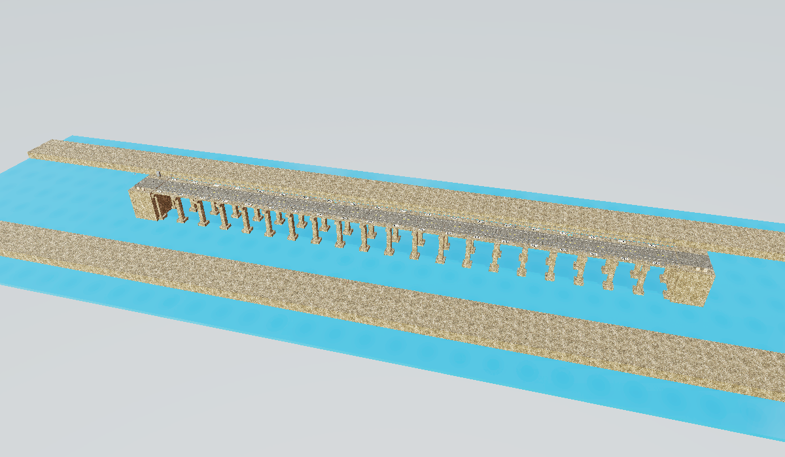

# Long-Bridge UAV Inspection

**Inspect a 72-120 m bridge through a local onboard camera, retain an inspection
record, and submit three correctly localized, image-supported defects.**



[Bridge detail](bridge-detail.png) · [Onboard damage image](agent-view.png) ·
[Intact repair patch](repair-view.png) · [Successful inspection video](inspection-flight.mp4).
[Steel truss](steel-overview.png) · [Maintenance layout](maintenance-overview.png).
Overviews are reviewer-only; the agent sees
one moving 384x384 perspective camera. All pictures are actual MuJoCo renders.

## What changed
The old 6 m, one-gap, globally calibrated masked camera is replaced by a long
two-sided bridge with repeated bays, trusses, piers, railings and normal repair
patches. Three randomized layouts cover concrete viaducts, steel through-trusses
and maintenance structures. Length is 72, 96 or 120 m; defects vary within episodes'
early, middle and far portions. No current pose or global camera is exposed.

The motivation is **active inspection plus long-horizon coverage and evidence
memory**. The agent must retain frame/location associations across the route.
Reports give no correctness feedback before finalization. Detection F1 gives
partial credit and counts duplicate/unsubstantiated reports as false positives.
External notes and scripts are allowed: this does not isolate neural context
memory from mapping, programming or perception.

UAV Search and Rescue remains a separate task (#39). Its intended challenge is
occlusion-driven spatial reasoning and active viewpoint selection, not this
bridge's long inspection inventory. The existing rescue pilot still needs a
stronger occlusion design before that claim is established.

## Validation, 2026-11-04
- Six development scenes, all three layouts and lengths: **6/6 reference successes**.
- Reference effort: 119-221 actions; all three defect reports correct, no false reports.
- Ten evidence/budget regressions and nine independent-replay integrity tests passed.
- Six-seed repeat-image, randomization and close-up reachability checks passed;
  all 256 repository tests passed after updating to upstream `17bef3a`.
- Pinned ALE `1cdbc02a1f3390e704747b33946304911f3105ad`: calibration measured
  F1=1.0; both the original gate and a fresh, isolated-verifier confirmation passed
  **untouched 0 / oracle 1**. The latter independently replays the private ledger.
- **Astra (`gpt-6-astra`, `xhigh`): F1=1.0, 3/3 defects, no false reports,
  112 actions, 56 simulated seconds, 475.5 s wall time.** This single pilot used a
  72 m maintenance scene. It completed normally, with no environment failure.

**This version is not yet frontier-hard.** Astra created a two-sided scan route,
saved images and an external inspection record, then submitted all three findings
after completing the survey. Repeated spans and more distance alone did not defeat
that strategy. Under-deck/behind-member defects and multi-view confirmation are
next design candidates, not implemented or validated claims.

The Astra pilot tested task commit `d5d27b7` with the shared-verifier transport.
Subsequent isolation hardening did not change the scene, prompt, actions or F1
definition. It was checked with the ALE oracle, not another Astra run. These are
development checks, not a sealed benchmark, general success-rate estimate or
controlled memory ablation.

## Verification boundary
The agent cannot read or edit the root-owned world service, ledger or evidence
directory. ALE captures that private state after the agent exits and restores it
in a **fresh verifier sandbox**. The verifier replays the actions, checks the
reported frame IDs and image hashes, and recomputes the score. It never accepts a
self-reported success or ledger from `/home/user/submission`. The current kit is
byte-identical to the upstream canonical copy.

[Validation evidence](validation-evidence.json) · [Successful example](success-example.json) ·
[Actual interaction](success-interaction.json).

The successful reference uses RGB to detect apertures and retains all findings.
It has **privileged, exact actuator calibration** for navigation, but no defect
list or seed. It is a feasibility upper bound, not a matched agent baseline.

## Reproduce
From the pinned `vendor/ale` (see the repository contribution setup):

```bash
VIRTUAL_ENV= uv run ale lint ../../tasks/uav/bridge_damage_inspection
VIRTUAL_ENV= DOCKER_HOST=unix:///var/run/docker.sock uv run ale validate ../../tasks/uav/bridge_damage_inspection --runs-dir /tmp/long-bridge-gate
```

Inside the task image with the task mounted, use `/opt/venv/bin/python3`:
`tests/review/test_long_bridge.py -v`,
`tests/review/test_bridge_replay.py -v`,
`tests/review/check_randomization.py`, or
`tests/review/review_task.py --out /tmp/bridge-review --seeds 101 102 103 104 105 106`.

## Scope and assets
Stabilized planar flight, visible slab openings, and simulation only. Not subtle
fatigue diagnosis, articulated drone flight or a hardware-validated digital twin.
Scene geometry is authored here. Poly Haven CC0 textures/scans, licensed Menagerie
Crazyflie geometry, and MuJoCo's lighting probe retain the pinned URLs, hashes and
notices in `environment/visual_assets.json` and `environment/LICENSE.*`.
No private lab scene or generated promotional image is used.
