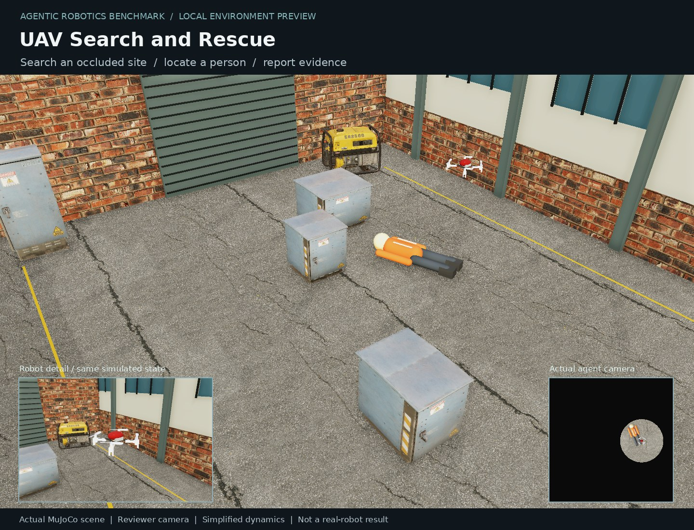

# UAV Search and Rescue

**Draft task candidate.** Search an occluded industrial site using a UAV's local RGB view, then report the target position and an authentic observed frame before the simulation-time budget expires.



The large image is a reviewer camera. The inset and [agent-view.png](agent-view.png)
show the actual restricted observation. Both use the same PBR scene, not a marketing mockup.

## Visual refresh

MuJoCo 3.16 Filament runs on CPU Vulkan (lavapipe), with no GPU fallback.
The scenes include CC0 industrial scans, correctly scaled surface UVs, normal/roughness
maps, fixed-exposure lighting, and spatial supersampling. Temporal post-processing is
disabled so an unchanged scene produces identical camera pixels. Tracking stickers
remain visible; no semantic overlays or privileged state are added to observations.

Original action semantics, calibrated cameras, collision proxies, scoring and budgets
are retained. Detailed scenery has zero mass and contact response. This is a visual
upgrade of a lightweight simulation, not a claim of hardware-accurate dynamics.

## Randomization

Target position and heading, equipment positions and dimensions; lighting and surrounding details. Rejection sampling keeps the target clear of opaque equipment roofs.

The private seed persists throughout an episode. Reconnecting does not resample the
scene or restore budgets. Six-seed determinism/variation/phase checks passed.

## Validation

- Image-only scripted reference: **3/3** private randomized validation scenes.
- Development demonstration: seed 101, 27 actions, 0 contacts.
- Real ALE gate: **untouched 0.0 / oracle 1.0**, after measuring the new anchor.
- Anchor `success_rate`: 1.000000000, from 1 actual oracle runs.
- CPU only; no Astra/frontier-model calls. Pinned engine `90a7c1cfa649c5dbf1078714773f99840e44cba3`.
- Shared-service security probe: 14 permission/forgery checks, forged success scored zero.

The numbers above are feasibility checks, not model difficulty measurements
or a sealed benchmark test set.

[Raw evidence](validation-evidence.json) · [Success example](success-example.json) ·
[Interaction log](success-interaction.json)

## Reproduce

From `vendor/ale`:

```bash
uv run ale lint ../../tasks/uav/time_limited_search_and_rescue
uv run ale validate ../../tasks/uav/time_limited_search_and_rescue
```

Inside the task image, `tests/review/check_randomization.py` checks six scenes and
`tests/review/review_task.py --out /tmp/review --seeds 101 102 103` captures reviewer evidence.

## Limits

Detection and localization only, without pickup or physical rescue. Altitude-stabilized planar UAV motion and a local orthographic view. The target is a stylized orange mannequin. Some random scenes place it close to the initial field of view; this difficulty tail is recorded, not excluded from the reference results.

Keep this PR in **Draft**. Independent review, task registration and frontier-model
difficulty evaluation remain pending. Scanned props do not make a task difficult by
themselves. Earlier failures and pilot images are retained in the author's local logs.

## Assets

Powered by Poly Haven: CC0 scanned utility cabinet, generator, concrete barrier and
surface textures. Menagerie Crazyflie/Go1 visual meshes retain their original licenses.
The lighting probe ships with the Apache-2.0 MuJoCo package. Pinned URLs, SHA256 hashes
and notices are in `environment/visual_assets.json` and `environment/LICENSE.*`. No commercial
warehouse pack, private laboratory scene or generated marketing image is included.
