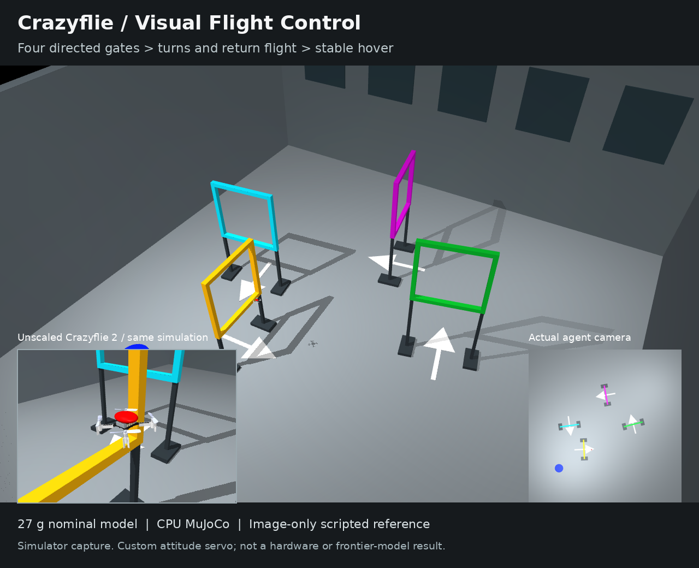
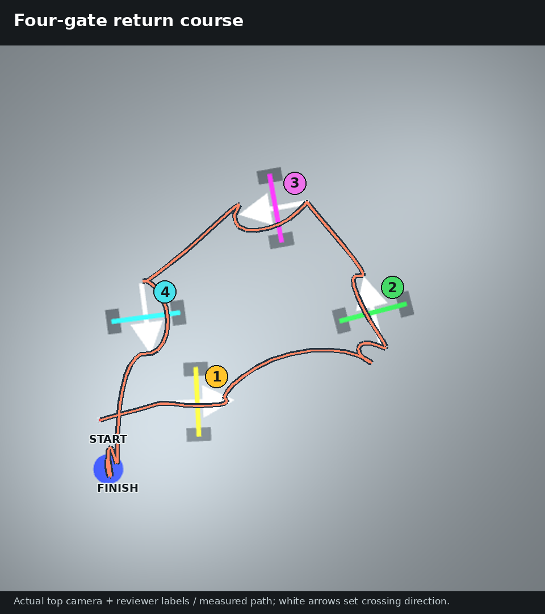

# Successful Reference Submission

The oracle supplies `run.sh` and `policy.py`, completes the exploration scene,
and leaves its initial/final camera PNGs plus `example_interaction.json` in the
collected submission. The verifier then runs that controller on four new scenes.
The recorded demonstration itself is not a grading input.

The image above is an actual simulator capture from development seed 101. The
large view and close-up are reviewer cameras; the inset is the real agent camera.
It is not a photorealistic rendering, an LLM run or a hardware demonstration.

Four gates require yellow > green > magenta > cyan crossings. White floor arrows
specify direction; the route turns and returns toward the starting side. The
route image overlays reviewer labels and the measured trajectory on a real top
camera capture. These overlays are not supplied to the controller.

Six development seeds (101-106) completed all four gates and the required hover
without a collision, in 30.9-41.9 simulated seconds under the unchanged 60-second
budget. The reference reads gate orientation and arrow direction from RGB, not
from private scene parameters. ALE calibration provenance is in
`../verify/anchor.json`; the old three-gate calibration is not reused. These checks
demonstrate solvability, not frontier-model difficulty or broad control robustness.

See [the reviewer guide](../tools/REVIEW.md) to reproduce the tests, generate a
video and check that forged success and reset attempts receive no credit.
